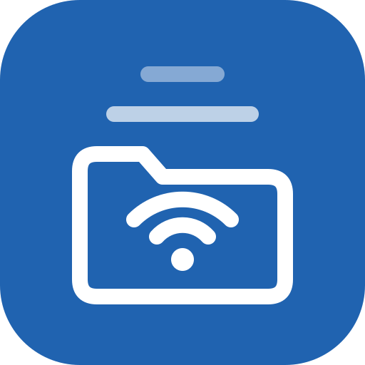
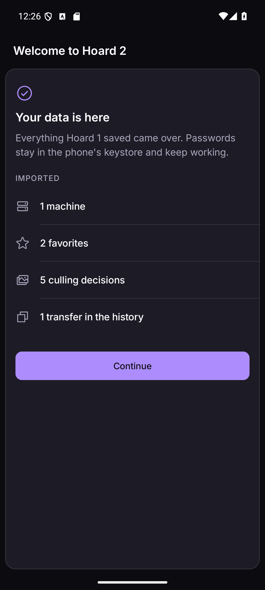
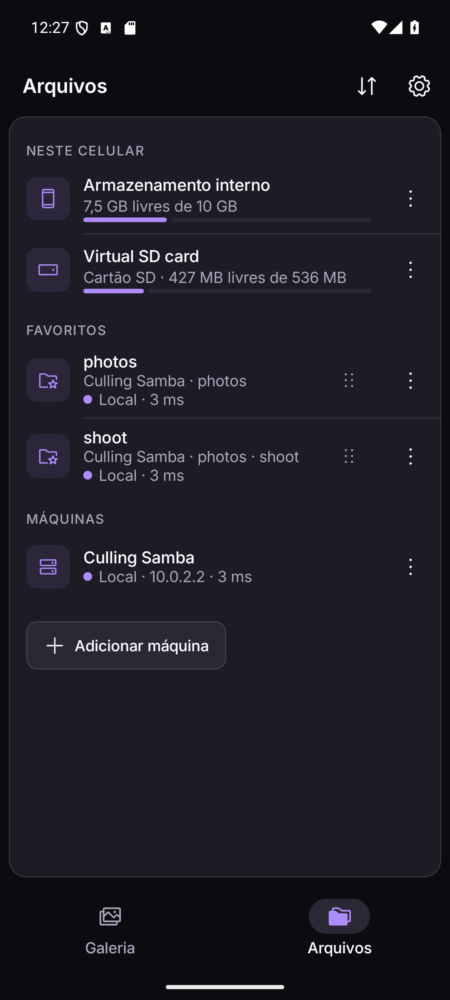
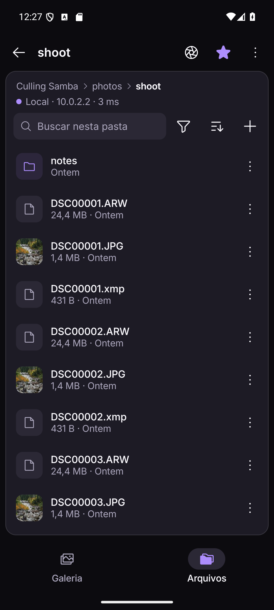
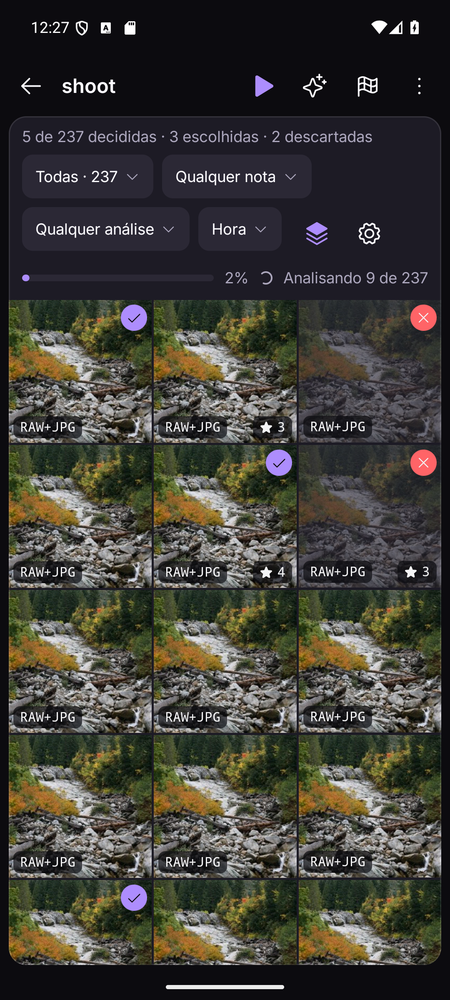
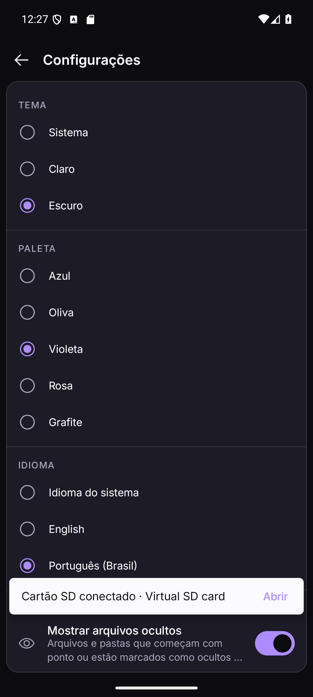

# Hoard

A file manager for Android: the phone's own storage, USB drives and SD cards, and the shared folders of your computers over SMB, with copy, move and share between any of them. It also culls photo shoots (RAW, JPEG and RAW+JPEG pairs) straight from the card, with help spotting blurry shots, closed eyes, bad exposure and bursts, and copies the picks anywhere ([ADR 0008](docs/adr/0008-culling.md), [ADR 0009](docs/adr/0009-assisted-culling.md)). Save your **machines** once, each with every address it answers on (local network IP, Tailscale IP or MagicDNS name), and Hoard picks the one that is reachable right now.

Free and open source (AGPL-3.0-or-later). Since **2.0.0** Hoard is a native Android app, Kotlin + Jetpack Compose ([ADR 0019](docs/adr/0019-native-app.md)), with two tabs: **Files** (everything below) and **Gallery** (photos on the phone and on [hoard-server](server/), in progress).

## Hoard 2

Hoard 1.x was a Capacitor + React app (a WebView over a native Kotlin plugin). Hoard 2 rebuilt every screen natively,
at parity, over the same native core (SMB, transfers, the image core with LibRaw, XMP), and **2.0.0 replaced it**:
same application id, same signing key, so the phone's Hoard upgrades in place. The first launch after the upgrade
imports Hoard 1's database (machines, favorites, culling decisions and analyses, transfer history, settings, theme,
palette and language); saved passwords stay in the phone's keystore and keep working, and Reveal's links keep
opening. The upgrade test is in [`docs/testing/hoard-2.0.0.md`](docs/testing/hoard-2.0.0.md).

| After the upgrade                                         | Files                                       | Browse (no password asked)                                    | Culling decisions kept                                     | Settings kept                                     |
| --------------------------------------------------------- | ------------------------------------------- | ------------------------------------------------------------- | ---------------------------------------------------------- | ------------------------------------------------- |
|     |  |  |  |  |

More screens (phone, landscape, tablet, light and dark) in [`docs/testing/native-2b/`](docs/testing/native-2b/)
(Files), [`native-2c/`](docs/testing/native-2c/) (culling) and [`native-2d/`](docs/testing/native-2d/). Hoard 1.x
screenshots stay in [`docs/screenshots/`](docs/screenshots/) as history.

## Features

- **Locations** ([ADR 0005](docs/adr/0005-locations.md)): the phone's internal storage and every USB drive or SD card are browsed like SMB shares, with the same features (sort, filter, search, thumbnails, multi-select, text editor, streaming to other apps, web viewer, favorites). The home screen lists **This phone** first (used/free bar per volume); drives appear and disappear live, with a "USB drive connected · Open" notice. Needs Android's **All files access** (explained on first launch, a Settings switch; Hoard is sideloaded, see the ADR for the Play Store implication); without it SMB keeps working and a drive can still be opened folder by folder through the system picker. `Android/data` and `Android/obb` are shown as not accessible (Android 11+). Ejecting happens in Android's storage settings (apps cannot eject). Copying and moving between any locations: see Transfers.
- **Photo culling** ([ADR 0008](docs/adr/0008-culling.md)): **Cull photos** in any folder with photos, on any location (a camera card in a USB reader, a NAS share, the phone). RAW + JPEG pairs are one shot (RAW-only and JPEG-only work too); a dense grid in capture order (EXIF with sub-seconds) with burst hints, filters (picked, rejected, not decided, stars) and progress. Full-screen viewer: swipe to page, swipe up to pick and down to reject, 1–5 stars, auto-advance, undo, filmstrip, camera data overlay, pinch or double tap to **100%** (region tiles; RAW-only shots rendered by LibRaw), and side-by-side **compare** with synchronized zoom and focus scores. The embedded preview shows first, the better image replaces it; the next shots are prepared natively, so paging lands on a ready image. Decisions are saved in the app (never next to the photos) and survive restarts. Finish: **Copy picks to…** any location (RAW + JPEG, RAW only or JPEG only; the last destination is remembered per source; copied by the transfer engine, with its progress and conflict questions) and **Delete rejects** (permanent, counted, refused cleanly on read-only folders).
- **Assisted culling** ([ADR 0009](docs/adr/0009-assisted-culling.md)): while a folder is open, every shot is analysed on the phone, offline, in the background (the shot on screen first, ~0.2 s each): sharpness of the face or the sharpest area, faces and closed eyes (ML Kit, bundled model), exposure with a histogram, and a similarity signature. Bursts are grouped by capture time and similarity (a scene change splits a run, near-identical frames a bit further apart join it) and **stacked** in the grid with their best frame crowned; marks for blurry, eyes closed, over- and under-exposed; sort by sharpness and filter by problem. **Suggest** proposes keeping the best frame of each burst and rejecting the rest and every flagged shot, with the reason ("Blurrier than DSC07705", "Eyes closed"); nothing changes until you accept all, a burst or a shot. Compare opens on a burst's top two; the viewer zooms to a face. Results are cached in the app, so reopening a card does not measure again. Sensitivity and burst gap in Settings › Culling.
- **Machines** with an ordered list of addresses (drag handle or Move up/down buttons, optional port). The address kind (local, Tailscale, other) is detected live from the host and local addresses sort first. New machines are prefilled from SMB servers found on the network (mDNS). **Test connection** tries every address and reports reachability, latency, sign-in and whether it is the same server. Passwords go only to the Android Keystore (`setCredentials`); on edit an empty password keeps the saved one.
- **Edit in Reveal** ([ADR 0010](docs/adr/0010-edit-in-reveal.md)): with [Reveal](https://github.com/henriquefps/reveal), the RAW editor, installed, **Edit in Reveal** hands photos over from the culling viewer (the shot on screen), the culling page (all picks, or the shots the grid shows) and a browser selection, RAW + JPEG pairs together, read-only, in place for the phone and drives and streamed from SMB shares, with the culling decisions (stars, pick, reject) as values Reveal reads. Nothing shows without Reveal.
- **Ratings as XMP sidecars** ([ADR 0011](docs/adr/0011-culling-sidecars.md)): in folders Hoard can write (phone, SD card, USB drive, writable SMB shares) every decision goes into the shot's `.xmp` sidecar (`xmp:Rating`, `digiKam:PickLabel`), merged into an existing one without touching Lightroom's develop settings or anything else, never over a malformed one; ratings made in Reveal, Lightroom, darktable or digiKam show in Hoard when the folder opens or the app comes back. Read-only folders keep decisions in Hoard and say so. **Copy picks** writes the same sidecar at the destination. Optional hidden `.name.xmp` files. Settings › Culling.
- **Automatic route detection** ([ADR 0002](docs/adr/0002-machines-addresses-route-detection.md), `android/native/.../route/RouteEngine.kt`): every address is probed in parallel, the first reachable one in priority order wins as soon as that is certain, then Hoard connects with the pinned **server GUID**. An address answered by another server (`GUID_MISMATCH`) is skipped like an unreachable one; the GUID is pinned on the first connect and can be cleared ("Re-pin"). Sessions are reused and reopened when they expire; routes are rechecked when the app resumes and when the network changes. **The route in use is always visible** ("Local · 192.168.1.155 · 8 ms") on the Files tab, the machine list and the browser header.
- **Browser**: shares, folders and files with a breadcrumb trail, Android back goes up a folder (or leaves selection mode first). Sort (name, size, date; folders first), filter by kind, search inside the folder, hidden files on demand. Lists are lazy, for folders with thousands of entries, and each folder keeps its scroll position when you come back. Image and video **thumbnails** load lazily for visible rows (cached); images open in a built-in viewer (swipe through the folder, zoom). Tap to open: videos, music and large files **stream** to the app you pick (VLC starts at once and can seek, nothing is downloaded first), `.html` pages open in a built-in viewer with their folder served by a local web server so relative CSS/JS/images load (and "Open in browser" hands them to Chrome), small files are cached then opened ([ADR 0004](docs/adr/0004-streaming-and-local-web-server.md)); "Open with…" always shows the chooser; row menu or long press for download, rename, delete (recursive for folders, confirmed), copy path, add to favorites; multi-select for copy, move, share and delete. Every error code has its own state and next step (wrong password → edit credentials, different server → explanation, unreachable → retry with the routes tried).
- **Text viewer and editor**: text files open in Hoard instead of another app (the row menu keeps "Open with another app"). Markdown renders natively (GFM headings, lists, task lists, tables, quotes, highlighted code with "Copy code", Mermaid diagrams in an offline WebView); relative images load from the share as thumbnails, web and `data:` images too, and links to other `.md` files open in the viewer. Code is highlighted with per-language grammars ([Highlights](https://github.com/SnipMeDev/Highlights), 17 languages; a lighter tokenizer for JSON, YAML, TOML, INI, SQL, XML), with line numbers, soft wrap, find and text size; JSON pretty-prints, CSV shows as a table. Edit mode: find and replace, Editor / Split / Preview for Markdown, Mermaid and CSV (split on wide windows), save back (atomic on the server: temp file + rename), an unsaved-changes guard, a conflict dialog when someone else saved meanwhile (reload theirs, overwrite, save as a copy), and New text file in the browser. Encodings are detected (UTF-8, UTF-16 with BOM, windows-1252) and kept on save, as are CRLF line endings. Files above 5 MB can be opened read-only, first 5 MB only.
- **Favorites**: pin any folder or share; shown on the Files tab with the machine's route; rename, remove and reorder (drag).
- **Transfers between any locations** ([ADR 0007](docs/adr/0007-transfers-any-location.md)): copy or move files and whole folders between the phone, USB drives / SD cards, SMB shares (same or different machines) and folders Android grants. Multi-select → **Copy** / **Move** puts them on a clipboard (a bar at the bottom shows what is on it; navigate anywhere and **Paste here**), or **Copy to… / Move to… / Download / Upload** opens a destination picker (recent destinations, this phone, drives, favorites, machines and shares, new folder). One native engine: a scan with totals first, free-space check, a hidden partial file per file that is verified before it gets its name, modified times kept, moves inside one location are a single rename, moves elsewhere delete each source only after its copy is verified, server-side copy inside one SMB share. Conflicts: ask (one question with "do the same for the others"), keep both, replace or skip. Jobs survive the app being killed, a dropped connection (failover across the machine's addresses, resuming at the byte written, uploads included) and a drive pulled out (Retry runs only the failed files). The queue shows from → to, files and bytes, speed, time left, the current file and the host in use, per-file errors, retry, cancel and open destination; on phones it opens in a bottom sheet from the top bar's progress indicator, on tablets as a screen.
- **Share in and out**: **Share** on selected files opens Android's share sheet (local files in place; SMB files streamed, or cached first when small). Hoard is also a share target: files shared from any app open **Save to Hoard**, which saves them to any location, an SMB share included.
- **Settings**: theme (system, light, dark) and color palette, language (also in Android 13+'s per-app language page), hidden files, default sort, default conflict policy, the folders Hoard may write to (release access), route check timeout, about. Settings › Licences lists every component Hoard ships ([`docs/licences.md`](docs/licences.md)).
- English and Portuguese (Brazil).

## Server

[`server/`](server/README.md) is **hoard-server**, the self-hosted photo server shared by Hoard, [Reveal](https://github.com/henriquefps/reveal) and (later) a web gallery: edits and library metadata, smart previews, original backups and read-only NAS folders, one revocable key per device. It was Reveal's `reveal-sync` and moved here unchanged ([ADR 0012](docs/adr/0012-hoard-server.md)); its protocol of record is [ADR 0013](docs/adr/0013-server-protocol.md) (`/v1`, frozen: additions only). Go + SQLite, one static binary or the image `ghcr.io/henriquefps/hoard-server`, released from `server-v*` tags (the app keeps `v*`). The app does not talk to it yet.

## Stack

Kotlin, Jetpack Compose + Material 3 re-themed to the hfps identity (Inter, Phosphor icons), Navigation Compose,
Room, coroutines and Flow, WorkManager, [smbj](https://github.com/hierynomus/smbj), LibRaw over JNI and ML Kit face
detection (the image core, [ADR 0006](docs/adr/0006-image-core.md)), Robolectric + Roborazzi screenshot tests. One
Gradle project ([ADR 0019](docs/adr/0019-native-app.md)). Server: Go, SQLite (pure-Go `modernc.org/sqlite`),
distroless image ([ADR 0012](docs/adr/0012-hoard-server.md)); its web gallery is Vite + React ([ADR 0018](docs/adr/0018-web-gallery.md)).

## Run and build

Android builds need the Android SDK and JDK 21. The bun scripts default to the Mac's paths
(`~/Library/Android/sdk`, Android Studio's bundled JBR) and respect `ANDROID_HOME` / `JAVA_HOME` when set:

```sh
bun run android:debug    # ./gradlew :native:assembleDebug → android/native/build/outputs/apk/debug/native-debug.apk
bun run android:release  # signed, R8-minified release under `skv run hoard` → android/native/build/outputs/hoard/hoard-<version>.apk
bun run android:test     # ./gradlew testDebugUnitTest lint (every module)
```

Or from `android/` (a fresh checkout needs `local.properties` with `sdk.dir=…`):

```sh
./gradlew testDebugUnitTest                 # JVM + Robolectric tests of every module
./gradlew :native:verifyRoborazziDebug      # screenshot goldens (recordRoborazziDebug re-records them)
./gradlew lint
./gradlew :native:assembleRelease           # unsigned unless the signing variables are set
```

The debug build has the release's application id (`dev.hfps.hoard`) and the debug key: use it on an emulator. It
cannot install over a release Hoard (different signature), and uninstalling Hoard to make room deletes its data.

**Release signing.** The release keystore (RSA 4096, alias `hoard`, the one Hoard 1 was signed with) is never in the
repo: it lives in the local `skv` vault, group `hoard` (`HOARD_KEYSTORE` as a file, `HOARD_KEYSTORE_PASSWORD`,
`HOARD_KEY_ALIAS`, `HOARD_KEY_PASSWORD`). `bun run android:release` runs Gradle under `skv run hoard`, and
`android/native/build.gradle.kts` signs only when those variables are present; without them Gradle warns and builds
`hoard-<version>-unsigned.apk`. Check a build with `apksigner verify --print-certs <apk>`. The keystore must be kept:
updates only install over an app signed with the same key.

The server is built and tested on its own, from `server/` (Go version from `server/go.mod`):

```sh
cd server && go vet ./... && go test ./...   # unit, end-to-end and reveal-sync compatibility tests
docker build -t hoard-server .               # the image; see server/README.md to run and deploy it
```

## Project layout

```
android/
  native/             the app (:native, dev.hfps.hoard): route/ (route engine), transfers/ (bookkeeping over the
                      engine), files/ (browser rules), cull/ (culling logic, assist, XMP precedence), smb/ (gateway,
                      file service, actions), data/ (settings), ui/ (shell, first-launch import, Files, Gallery,
                      culling, viewers, machines, settings)
  core/smb/           SMB (smbj), Keystore credentials, locations (HoardFs: SmbFs, PathFs, SafFs, volumes),
                      the transfer engine (TransferRunner, WorkManager), streaming + StreamProvider, share in/out,
                      Reveal hand-off, culling's native side
  core/image/         the image core (ADR 0006): LibRaw (vendored, src/main/cpp), decoders, caches, assisted-culling
                      measurements (analysis/, ADR 0009)
  core/xmp/           XMP sidecars: read, merge, write (ADR 0011)
  core/data/          Room (schema = Hoard 1's v7) and the one-time import of Hoard 1's database
  core/designsystem/  hfps theme, Inter, Phosphor icons, components
  scripts/            theme and icon generators
server/               hoard-server (Go, ADR 0012/0013) and its web gallery (server/web, ADR 0018)
docs/adr/             architecture decisions
docs/testing/         test reports, Samba containers and tools for end-to-end tests
```

## License

[AGPL-3.0-or-later](LICENSE).
