# Hoard

A file manager for Android: the phone's own storage, USB drives and SD cards, and the shared folders of your computers over SMB. Save your **machines** once, each with every address it answers on (local network IP, Tailscale IP or MagicDNS name), and Hoard picks the one that is reachable right now. Browse shares and folders, pin favorite folders, and copy files to the phone's storage.

Free and open source (AGPL-3.0-or-later). The whole UI is built and runs in the browser against an in-memory SMB mock; on Android the native Kotlin plugin (smbj, Storage Access Framework, WorkManager transfers) implements the same contract ([ADR 0001](docs/adr/0001-capacitor-native-smb-plugin.md)).

On Android (1.3.0, emulator): phone storage, a removable drive, favorites and machines; the first-run permission screen; the drive-connected notice; internal storage with thumbnails.

| Home                                                                            | All files access                                                       | Drive connected                                                                | Internal storage                                                                   |
| ------------------------------------------------------------------------------- | ---------------------------------------------------------------------- | ------------------------------------------------------------------------------ | ---------------------------------------------------------------------------------- |
| 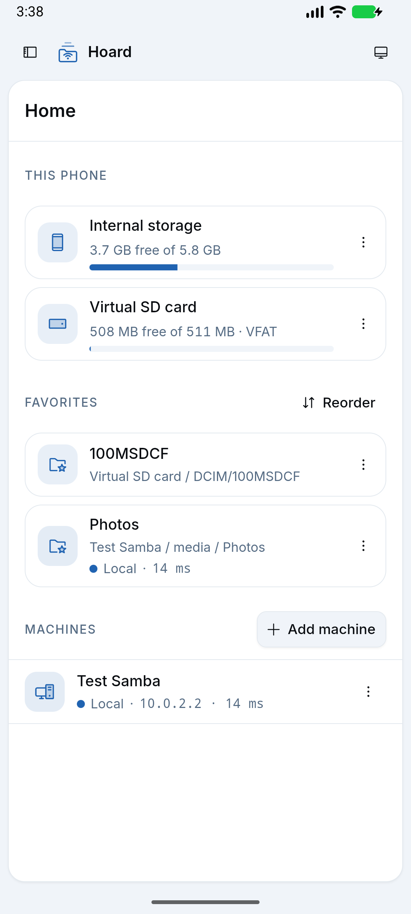 | 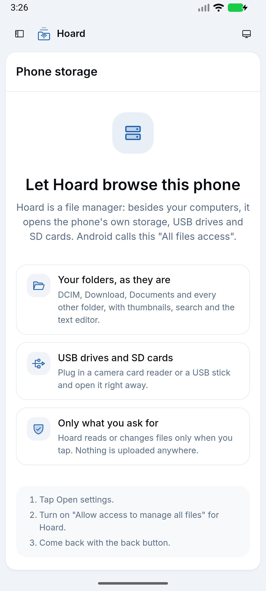 | 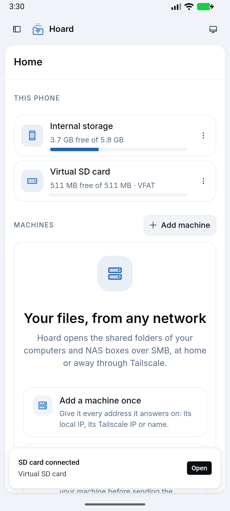 | 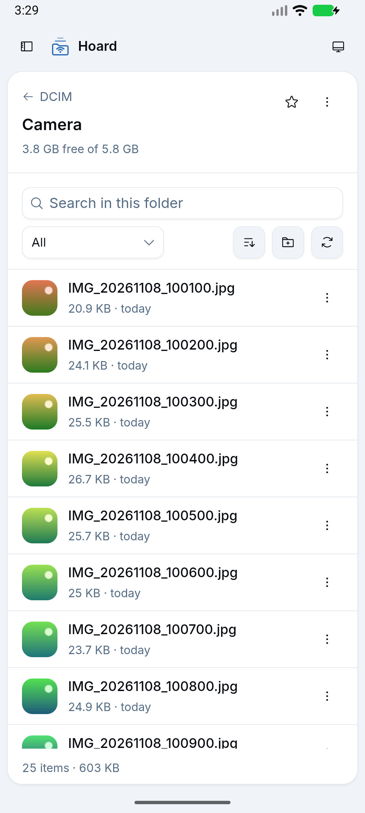 |

On Android (1.0.0, real app against a Samba server):

| Home                                             | Browser with thumbnails                                             | Machine, every address tested                                      | Transfers, dark                                                         |
| ------------------------------------------------ | ------------------------------------------------------------------- | ------------------------------------------------------------------ | ----------------------------------------------------------------------- |
| 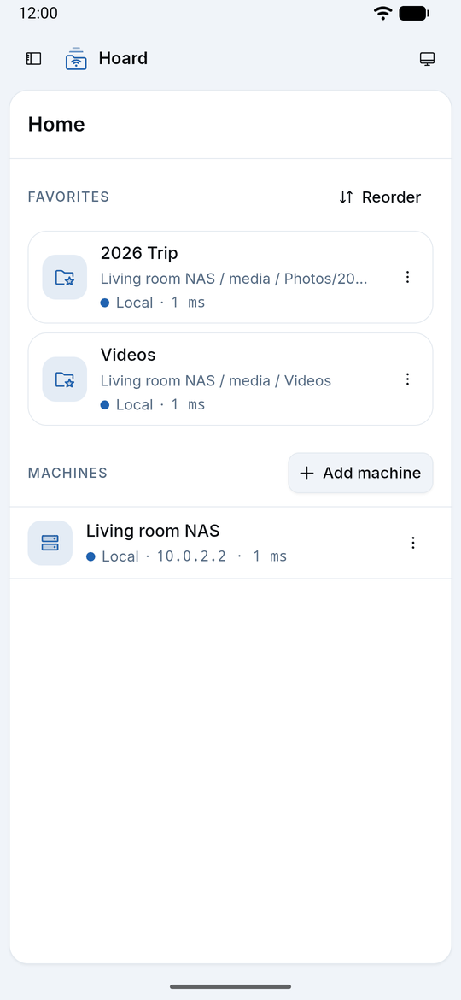 | 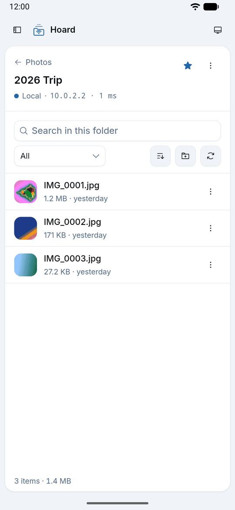 | 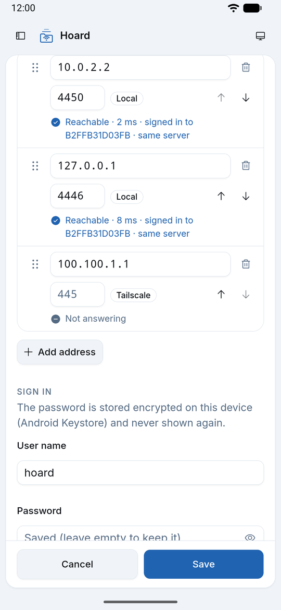 | 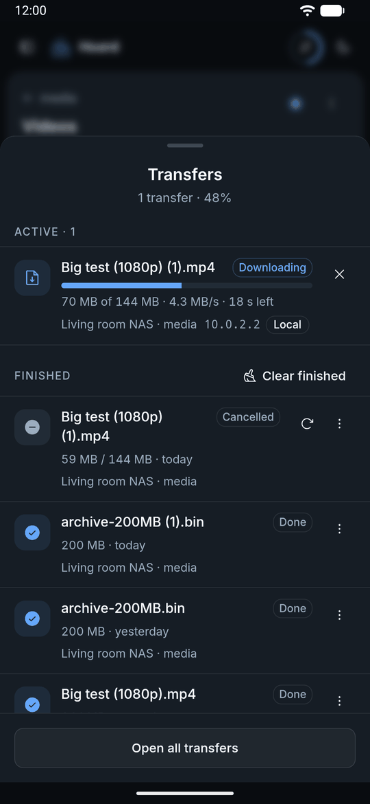 |

More in [`docs/screenshots/android/`](docs/screenshots/android/). The browser build (in-memory mock):

| Phone, light                                                   | Phone, dark                                                           | Desktop                                                                  |
| -------------------------------------------------------------- | --------------------------------------------------------------------- | ------------------------------------------------------------------------ |
| 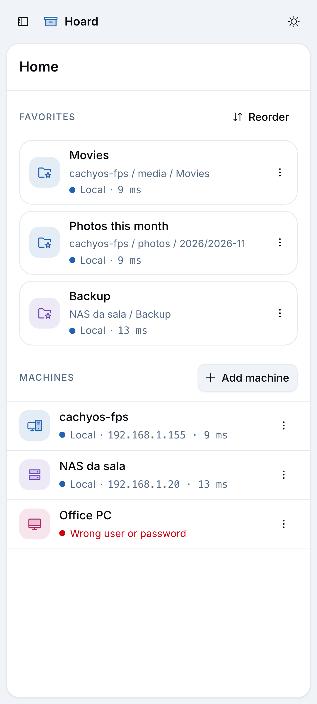                 | 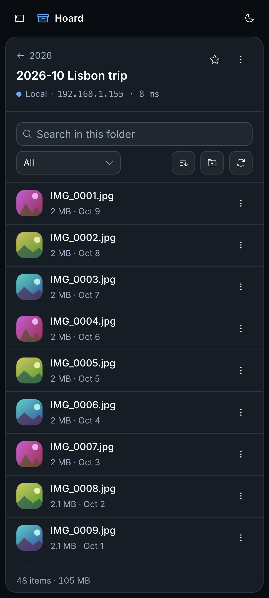    | 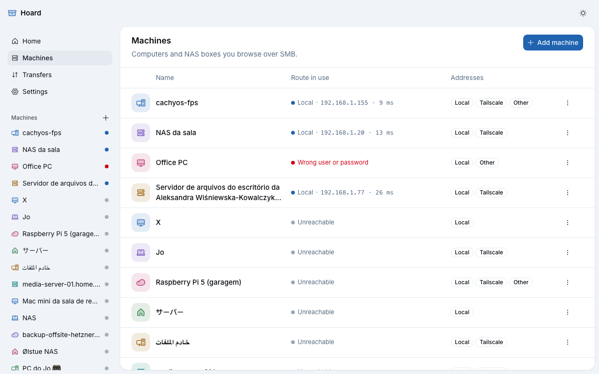                 |
| 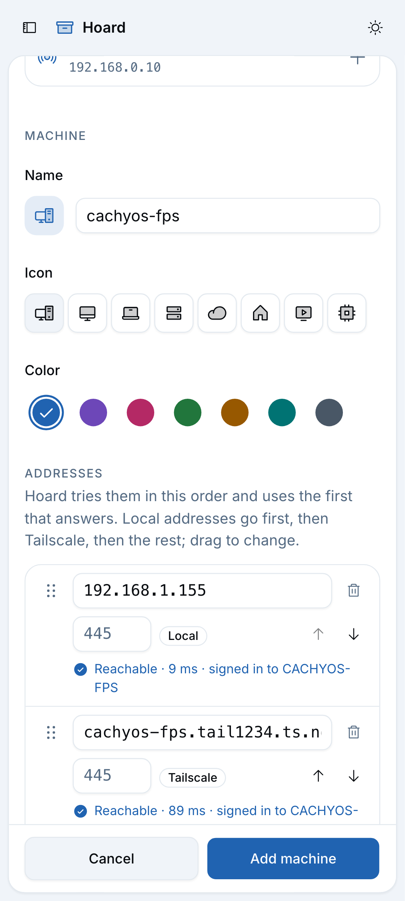 | 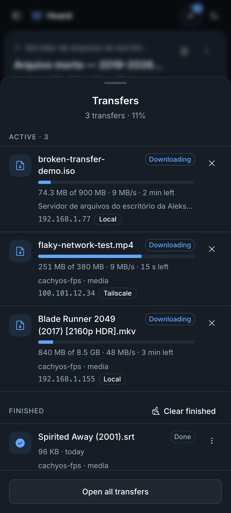 | 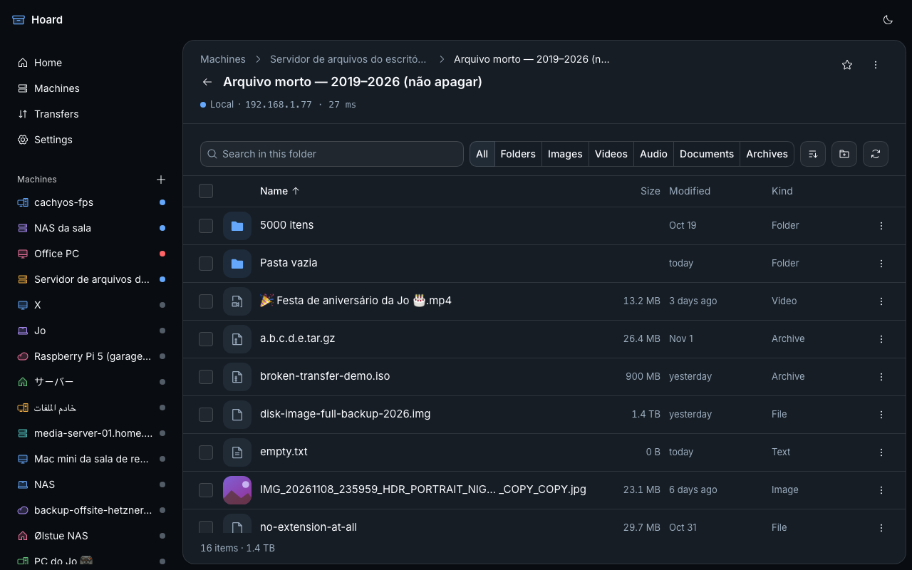     |
| 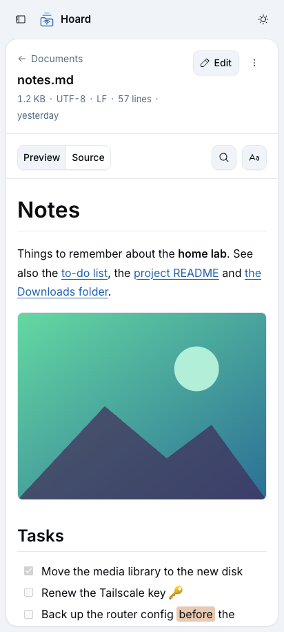    | 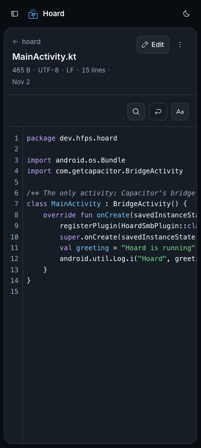                    | 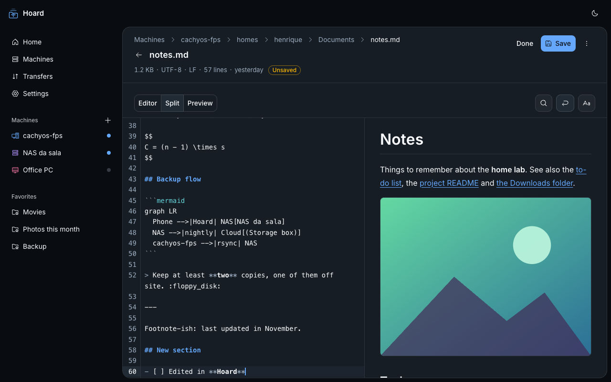 |

More in [`docs/screenshots/`](docs/screenshots/) (every screen at 412×915 and 1280×800, light and dark).

## Features

- **Locations** ([ADR 0005](docs/adr/0005-locations.md)): the phone's internal storage and every USB drive or SD card are browsed like SMB shares, with the same features (sort, filter, search, thumbnails, multi-select, text editor, streaming to other apps, web viewer, favorites). The home screen lists **This phone** first (used/free bar per volume); drives appear and disappear live, with a "USB drive connected · Open" notice. Needs Android's **All files access** (explained on first launch, a Settings switch; Hoard is sideloaded, see the ADR for the Play Store implication); without it SMB keeps working and a drive can still be opened folder by folder through the system picker. `Android/data` and `Android/obb` are shown as not accessible (Android 11+). Ejecting happens in Android's storage settings (apps cannot eject). Copying between any locations is the next phase.
- **Machines** with an ordered list of addresses (drag handle or Move up/down buttons, optional port). The address kind (local, Tailscale, other) is detected live from the host and local addresses sort first. New machines are prefilled from SMB servers found on the network (mDNS). **Test connection** tries every address and reports reachability, latency, sign-in and whether it is the same server. Passwords go only to the Android Keystore (`setCredentials`); on edit an empty password keeps the saved one.
- **Automatic route detection** ([ADR 0002](docs/adr/0002-machines-addresses-route-detection.md), `src/features/route/engine.ts`): every address is probed in parallel, the first reachable one in priority order wins as soon as that is certain, then Hoard connects with the pinned **server GUID**. An address answered by another server (`GUID_MISMATCH`) is skipped like an unreachable one; the GUID is pinned on the first connect and can be cleared ("Re-pin"). Sessions are reused and reopened when they expire; routes are rechecked when the app resumes and when the network changes. **The route in use is always visible** ("Local · 192.168.1.155 · 8 ms") on the home screen, the machine list, the sidebar and the browser header.
- **Browser**: shares, folders and files with a breadcrumb trail, Android back goes up a folder (or leaves selection mode first). Sort (name, size, date; folders first), filter by kind, search inside the folder, hidden files on demand. Card rows on phones, a table on desktop, virtualized for folders with thousands of entries. Image **thumbnails** load lazily for visible rows (4 at a time, cached). Tap to open: videos, music and large files **stream** to the app you pick (VLC starts at once and can seek, nothing is downloaded first), `.html` pages open in a built-in viewer with their folder served by a local web server so relative CSS/JS/images load (and "Open in browser" hands them to Chrome), small files are cached then opened ([ADR 0004](docs/adr/0004-streaming-and-local-web-server.md)); "Open with…" always shows the chooser; row menu or long press for download, rename, delete (recursive for folders, confirmed), copy path, add to favorites; multi-select for batch download and delete. Every error code has its own state and next step (wrong password → edit credentials, different server → explanation, unreachable → retry with the routes tried).
- **Text viewer and editor**: text files open in Hoard instead of another app (the row menu keeps "Open with another app"). Markdown renders with the pipeline from [markdown-preview](https://github.com/henriquefps/markdown-preview) (GFM tables and task lists, highlighted code, Mermaid, KaTeX, emoji, ==marks==); relative images load from the share as thumbnails and links to other `.md` files open in the viewer. Code and plain text (CodeMirror 6, only the visible lines are drawn, so 100,000-line logs scroll) have line numbers, highlighting, soft wrap, find, text size; JSON pretty-prints, CSV shows as a table. Edit mode: find and replace, Markdown editor / split / preview, save back with Ctrl/Cmd+S or the Save button (atomic on the server: temp file + rename), unsaved-changes guard on back and navigation, a conflict dialog when someone else saved meanwhile (reload theirs, overwrite, save as a copy), and New text file in the browser. Encodings are detected (UTF-8, UTF-16 with BOM, windows-1252) and kept on save, as are CRLF line endings. Files above 5 MB can be opened read-only, first 5 MB only. Small text is the one exception to "bytes never cross the bridge" ([ADR 0001](docs/adr/0001-capacitor-native-smb-plugin.md)).
- **Favorites**: pin any folder or share; shown on the home screen with the machine's route and in the sidebar; rename, remove and reorder.
- **Transfers** from SMB to a phone folder chosen with the Storage Access Framework (the last one is remembered), with a conflict policy (keep both, replace, skip). Bytes stream natively, never through the WebView; the queue shows progress, speed, time left and the host in use (so a failover is visible), with cancel, retry (resuming where it stopped) and clear finished. On phones the queue opens in a bottom drawer from the top bar's progress ring; the full list is at `/transfers`. The app reconciles with the native service on start and resume.
- **Settings**: theme and color palette, language, hidden files, default sort, default conflict policy, the folders Hoard may write to (release access), route check timeout, about. The browser build adds a simulated network switch (home, away on Tailscale, offline) and a worst-case data set (18 more machines, a 5,000-entry folder, unicode and very long names, a 1.4 TB file, a transfer that fails mid-way).
- English and Portuguese (Brazil).

## Stack

React 19, TypeScript, Vite, Tailwind CSS 4, shadcn/ui (`radix-vega`) in the hfps identity, Phosphor icons, Inter, TanStack Router, i18next, Capacitor 8 (Android), SQLite (`@capacitor-community/sqlite`, sql.js in the browser), Vitest, ESLint, Prettier, bun. Native SMB: Kotlin + [smbj](https://github.com/hierynomus/smbj) ([ADR 0001](docs/adr/0001-capacitor-native-smb-plugin.md)).

## Run and build

```sh
bun install
bun run dev          # browser, against the in-memory SMB mock and demo machines
bun run lint
bun run typecheck
bun run test
bun run build        # type-check + production bundle in dist/

bun run android:sync     # build + cap sync android
bun run android:debug    # sync + ./gradlew assembleDebug → android/app/build/outputs/apk/debug/app-debug.apk
bun run android:install  # debug build + adb install on the connected phone
bun run android:release  # sync + signed, R8-minified release APK → android/app/build/outputs/apk/release/app-release.apk
```

Android builds need the Android SDK (`~/Library/Android/sdk`) and JDK 21; the scripts use Android Studio's bundled JBR (`/Applications/Android Studio.app/Contents/jbr/Contents/Home`).

Native plugin tests (JVM) and the release build, from `android/` with that `JAVA_HOME`:

```sh
./gradlew testDebugUnitTest   # pure-logic tests; network tests are opt-in, see ADR 0001
./gradlew assembleRelease     # R8-minified release APK, unsigned unless the signing variables are set
```

**Release signing.** The release keystore (RSA 4096, alias `hoard`) is never in the repo: it lives in the
local `skv` vault, group `hoard` (`HOARD_KEYSTORE` as a file,
`HOARD_KEYSTORE_PASSWORD`, `HOARD_KEY_ALIAS`, `HOARD_KEY_PASSWORD`). `bun run android:release` runs Gradle under
`skv run hoard`, and `android/app/build.gradle` signs only when those variables are present; without them
Gradle warns and builds `app-release-unsigned.apk`. Check a build with
`apksigner verify --print-certs android/app/build/outputs/apk/release/app-release.apk`. The keystore must be kept:
updates to an installed app only install when signed with the same key.

In the browser, data lives in a sql.js database saved to `localStorage`; run `localStorage.removeItem("hoard.devdb")` in the console to reseed the demo machines.

## Project layout

```
src/
  plugins/smb/        HoardSmb plugin: definitions.ts (the contract), index.ts (registerPlugin),
                      web.ts + mockData.ts + mockLocal.ts (in-memory mock used by the browser and the tests)
  features/locations/ location ids, BrowseLocation (one place for SMB / device / volume calls),
                      volumes provider + notices, phone storage cards, location error states
  db/                 Db interface, Capacitor and sql.js adapters, migrations, queries, demo seed
  lib/                addressKind, pickRoute, files (kinds, sort, filter), format, taskQueue, theme,
                      text/ (encodings, line endings, Markdown link resolution, CSV)
  features/text/      text viewer and editor route (lazy chunk): CodeMirror, Markdown, find
  features/route/     reachability engine (route + session per machine), provider and status UI
  features/browse/    folder loading, file rows, toolbar, thumbnails
  features/machines/  address editor, host parsing, test connection, delete
  features/transfers/ transfer service (progress, reconcile), download dialog, queue page and drawer
  features/settings/  typed settings with defaults
  components/         AppShell, AppSidebar, Page + breadcrumbs, ResponsiveDialog, SortableList, ui/ (shadcn)
  routes/             one component per route (router.tsx wires them)
  i18n/               i18next setup, locales/en.json, locales/pt-BR.json
android/              Capacitor Android project; app/src/main/java/dev/hfps/hoard/smb/ is the native plugin
                      (sessions, srvsvc, credentials, NSD, SAF; transfer/ = WorkManager jobs; viewer/ = open + thumbnails;
                      stream/ = streaming provider, local web server, web viewer; location/ = HoardFs with
                      SMB, path and SAF implementations, volumes, volume events)
docs/testing/samba/   disposable Samba server for the opt-in native integration test
docs/adr/             architecture decisions
```

## License

[AGPL-3.0-or-later](LICENSE).
