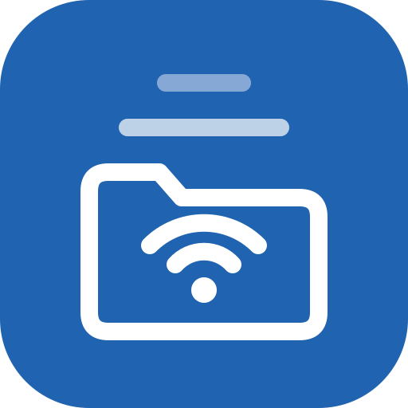
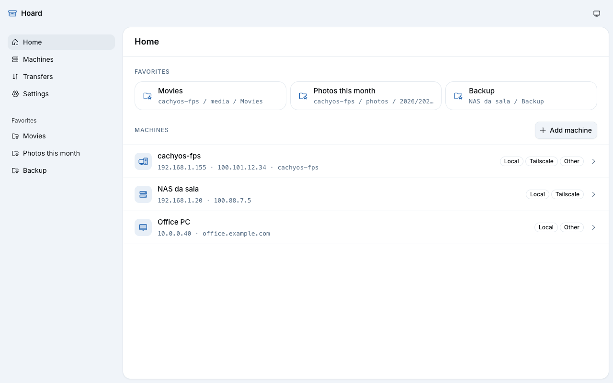
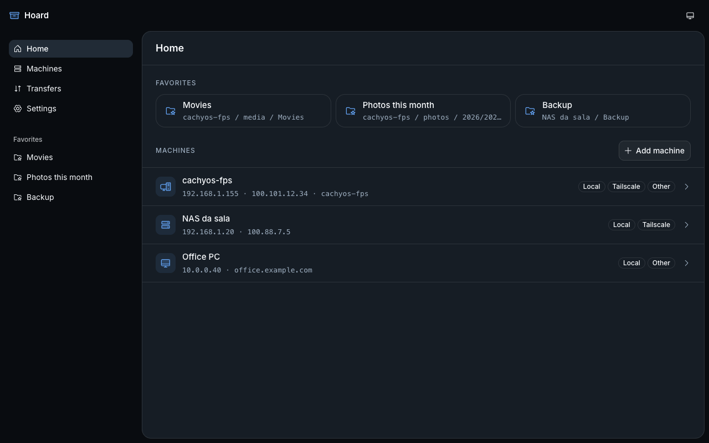
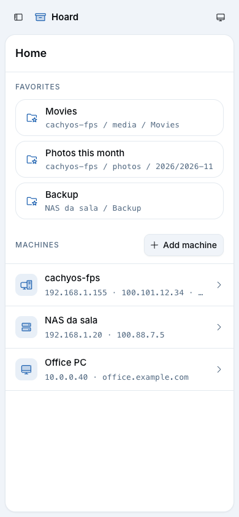
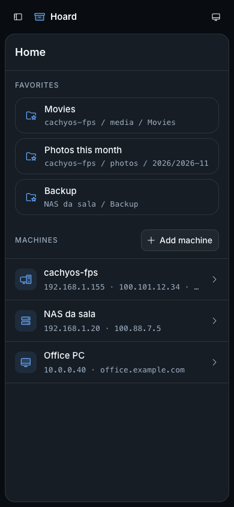

# Hoard

An SMB file client for Android. Save your **machines** once, each with every address it answers on (local network IP, Tailscale IP or MagicDNS name), and Hoard picks the one that is reachable right now. Browse shares and folders, pin favorite folders, and copy files to the phone's storage.

Free and open source (AGPL-3.0-or-later). Work in progress: this is the foundation (app shell, data layer and the native plugin contract); browsing, transfers and the native SMB code come next.

| Light                                                         | Dark                                                        |
| ------------------------------------------------------------- | ----------------------------------------------------------- |
|  |  |
|     |     |

## Planned features

- **Machines** with an ordered list of addresses; the address kind (local, Tailscale, other) is detected from the host.
- **Automatic route detection**: every address is probed in parallel with a native TCP connect to port 445, the first reachable one in priority order wins as soon as that is certain, rechecked when the app returns to the foreground or the network changes. The SMB **server GUID** is pinned on first connect, so a look-alike address on another network never receives the password ([ADR 0002](docs/adr/0002-machines-addresses-route-detection.md)).
- **Browse** shares, folders and files with a breadcrumb trail; sort, filter and search inside a folder; image thumbnails.
- **Favorites**: pinned folders on the home screen and in the sidebar, working through whichever address is reachable.
- **Transfers** from SMB to a phone folder chosen with the Storage Access Framework. Bytes stream natively, never through the WebView; transfers run in the background with a notification, resume after a drop and fail over to another address.
- **Open** a file with any app on the phone.
- English and Portuguese (Brazil).

## Stack

React 19, TypeScript, Vite, Tailwind CSS 4, shadcn/ui (`radix-vega`) in the hfps identity, Phosphor icons, Inter, TanStack Router, i18next, Capacitor 8 (Android), SQLite (`@capacitor-community/sqlite`, sql.js in the browser), Vitest, ESLint, Prettier, bun. Native SMB: Kotlin + [smbj](https://github.com/hierynomus/smbj) ([ADR 0001](docs/adr/0001-capacitor-native-smb-plugin.md)).

## Run and build

```sh
bun install
bun run dev          # browser, against the in-memory SMB mock and demo machines
bun run lint
bun run typecheck
bun run test
bun run build        # type-check + production bundle in dist/

bun run android:sync     # build + cap sync android
bun run android:debug    # sync + ./gradlew assembleDebug → android/app/build/outputs/apk/debug/app-debug.apk
bun run android:install  # debug build + adb install on the connected phone
```

Android builds need the Android SDK (`~/Library/Android/sdk`) and JDK 21; the scripts use Android Studio's bundled JBR (`/Applications/Android Studio.app/Contents/jbr/Contents/Home`).

In the browser, data lives in a sql.js database saved to `localStorage`; run `localStorage.removeItem("hoard.devdb")` in the console to reseed the demo machines.

## Project layout

```
src/
  plugins/smb/        HoardSmb plugin: definitions.ts (the contract), index.ts (registerPlugin),
                      web.ts + mockData.ts (in-memory mock used by the browser and the tests)
  db/                 Db interface, Capacitor and sql.js adapters, migrations, queries, demo seed
  lib/                addressKind (kind detection), pickRoute (route picker), theme
  components/         AppShell, AppSidebar, Page + breadcrumbs, ResponsiveDialog, ThemeMenu, ui/ (shadcn)
  routes/             one component per route (router.tsx wires them)
  i18n/               i18next setup, locales/en.json, locales/pt-BR.json
android/              Capacitor Android project; app/src/main/java/dev/hfps/hoard/smb/ is the native plugin
docs/adr/             architecture decisions
```

## License

[AGPL-3.0-or-later](LICENSE).
