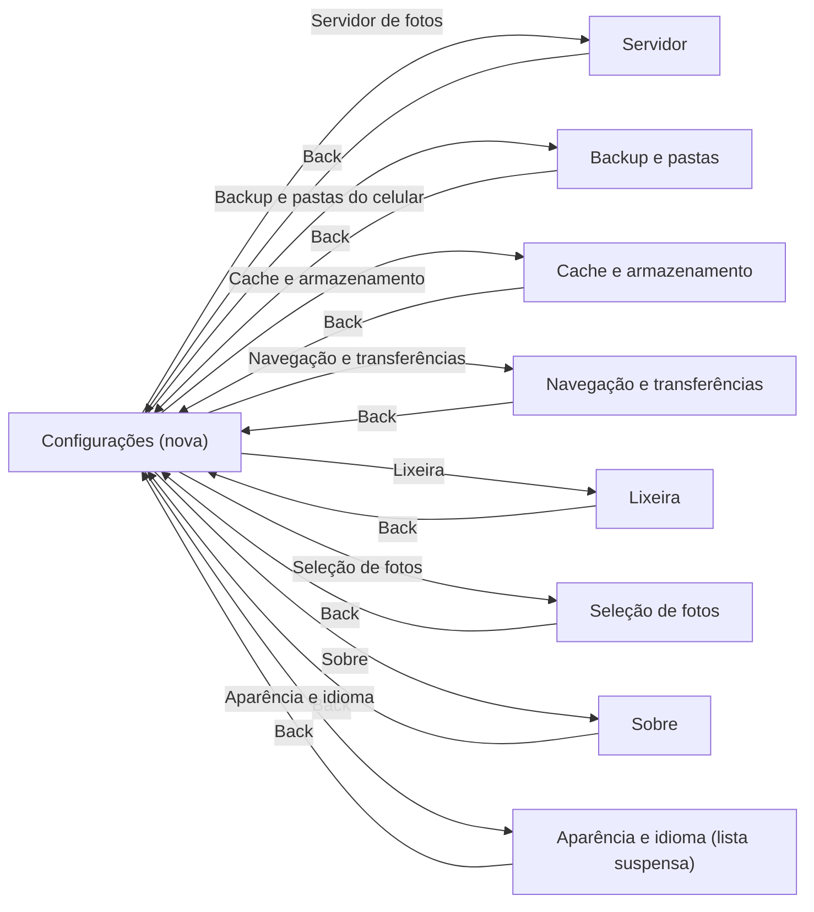

# Hoard — Configurações reorganizadas

Wireframe of an app, exported for an AI agent. It describes structure and content, not visual design: the wireframes are low fidelity (black, white and greys); build the real UI with the target stack and its own design system.

## Screens

- Configurações (nova) — phone 390×844 — status: changed — `screens/configuracoes-nova.md`
- Servidor — phone 390×844 — status: new — `screens/servidor.md`
- Backup e pastas — phone 390×844 — status: new — `screens/backup-e-pastas.md`
- Cache e armazenamento — phone 390×967 — status: new — `screens/cache-e-armazenamento.md`
- Aparência e idioma (lista suspensa) — phone 390×844 — status: new — `screens/aparencia-e-idioma-lista-suspensa.md`
- Navegação e transferências — phone 390×844 — status: new — `screens/navegacao-e-transferencias.md`
- Lixeira — phone 390×844 — status: new — `screens/lixeira.md`
- Seleção de fotos — phone 390×844 — status: new — `screens/selecao-de-fotos.md`
- Sobre — phone 390×844 — status: new — `screens/sobre.md`

## How to read the screen files

- Each screen file has one section per variant (platform and width). A variant is a full layout for that device class, not a responsive rule.
- Components are indented lists, top to bottom, as laid out. Children are indented under their container.
- "Vertical stack", "Horizontal stack" and "Grid" mark groups that belong together. "pinned to bottom" stays at the bottom edge of the screen; "floating" sits on top of the content.
- "Card container (outlined)" (or filled) is a group drawn as a card around its children.
- "List of 6 × (…)" is a repeated item: build it once and repeat it (a list, a horizontal list or a grid); the content under it is one item.
- "Note:" lines are the designer's remarks about the element above them.
- `screens/<name>.<platform>.png` is an image of each variant; `project.designer.json` is the editable project.
- Status: "current" = the screen as the app has it today; "changed" = a proposed change to a screen the app already has; "new" = a screen to add. A screen without a status does not say.
- "→ opens X" under an element, or after an item in its line ("Bottom navigation: Gallery (selected) → opens Gallery; Files → opens Files"): tapping (or clicking) it opens the screen X. The Flow section below has the whole map.

## Notes

- Itens que só aparecem em outros estados (não desenhados): • Sem servidor pareado: a linha "Parear com um servidor de fotos" (sub "Leia o QR code da página de configuração do servidor, ou cole o link") → tela de pareamento; some todo o resto da seção Servidor de fotos, menos "Pastas do celular". • Servidor em http://: o subtítulo do servidor soma "HTTP sem criptografia: fotos e a chave trafegam sem proteção. Use o endereço https:// do servidor quando houver." e o cadeado vira um aviso vermelho. • Situação: "Ainda não sincronizado"; "{n} decisões esperando para sincronizar"; erros "A última sincronização falhou: o servidor não estava ao alcance" / "O servidor não aceita mais este celular: pareie de novo" / "A última sincronização falhou ({erro})" / "O servidor recusou algumas decisões; elas serão enviadas de novo mais tarde ({erro})". "Sincronizar agora" fica desativado enquanto sincroniza. • "Comprimir vídeos" (sub "Reduza vídeos na GPU do servidor de fotos") → tela própria: só se o servidor tem o recurso de compressão. • Backup sem pastas: "Desligado: escolha as pastas do backup". Pastas mapeadas sem nenhuma: "Nenhuma ainda. Abra uma pasta de compartilhamento que o servidor também indexa, e o Hoard a reconhece lendo duas das fotos." • Armazenamento: "Pastas onde o Hoard pode salvar" (ajuda "O Android deu ao Hoard acesso a estas pastas. Libere uma para revogar o acesso.", uma linha por pasta com "Liberar"): só se o Android deu pastas pelo seletor. Acesso desligado: "Desligado: só suas máquinas e unidades escolhidas uma a uma." • Lixeira: Android < 12 "Precisa do Android 12 ou mais recente." (sem botão); não permitido: "Não permitido: o Android pede confirmação toda vez que o Hoard move fotos do celular para a lixeira dele." + "Permitir". • Cópias / links do Reveal vazios: "Nenhuma cópia neste celular." / "O Reveal não tem links para arquivos do Hoard." (sem botão); "Contando…" enquanto carrega. • A ajuda de "Se o arquivo já existir" muda com a opção; o texto de "Direção da ordem" muda com a ordem (Tamanho: Menores/Maiores primeiro; Modificado: Mais antigos/Mais recentes primeiro).

## Flow

What opens what: tapping (or clicking) the element in the first screen opens the second.

- Configurações (nova) → Servidor (from "Servidor de fotos" list row)
- Configurações (nova) → Backup e pastas (from "Backup e pastas do celular" list row)
- Configurações (nova) → Cache e armazenamento (from "Cache e armazenamento" list row)
- Configurações (nova) → Navegação e transferências (from "Navegação e transferências" list row)
- Configurações (nova) → Lixeira (from "Lixeira" list row)
- Configurações (nova) → Seleção de fotos (from "Seleção de fotos" list row)
- Configurações (nova) → Sobre (from "Sobre" list row)
- Servidor → Configurações (nova) (from "Back" in the top app bar)
- Backup e pastas → Configurações (nova) (from "Back" in the top app bar)
- Cache e armazenamento → Configurações (nova) (from "Back" in the top app bar)
- Navegação e transferências → Configurações (nova) (from "Back" in the top app bar)
- Lixeira → Configurações (nova) (from "Back" in the top app bar)
- Seleção de fotos → Configurações (nova) (from "Back" in the top app bar)
- Sobre → Configurações (nova) (from "Back" in the top app bar)
- Aparência e idioma (lista suspensa) → Configurações (nova) (from "Back" in the top app bar)
- Configurações (nova) → Aparência e idioma (lista suspensa) (from "Aparência e idioma" list row)

