# Compact collapsing header (1.9.1): before / after

Web mock (`bun run dev`), Chromium with touch, light and dark. Screens: a deep read-only SMB folder
(mock `cachyos-fps › raiz › mnt › crucial › Images › 2026-08-07 Park shoot — Sintra`, 7 crumbs),
phone storage (`DCIM/Camera`), the culling grid of the deep folder, transfers, settings. Viewports:
390×844 (phone portrait), **900×415 (the owner's phone in landscape)**, 844×390, 820×1180 (tablet).

File names: `<before|after>-<screen>-<viewport>-<light|dark>-<state>.jpg`, where `top` is the page
as it opens, `scrolled` is after scrolling the content down 600 px, and `scrolled-up` (after only,
deep folder) is after scrolling back up 80 px (quick-return in progress). `emu-*` are from the debug
APK on an emulator (1080×2340 at 420 dpi, i.e. 411×891 dp, landscape 891×363 dp under the system
bars), with a synthetic folder of generated JPEGs in phone storage.

## List area (% of the viewport height showing list rows)

Measured by sampling which element is under each pixel of a vertical line through the list
(`[role=listitem]` / `[role=gridcell]`), light theme; `before-metrics.json`, `after-metrics.json`.

| Screen          | Viewport | Before: top | Before: scrolled | After: top | After: scrolled |
| --------------- | -------- | ----------- | ---------------- | ---------- | --------------- |
| Deep SMB folder | 900×415  | 3 %         | 3 %              | 51 %       | 84 %            |
| Deep SMB folder | 390×844  | 58 %        | 58 %             | 66 %       | 86 %            |
| Phone storage   | 900×415  | 17 %        | 17 %             | 51 %       | 84 %            |
| Phone storage   | 390×844  | 61 %        | 61 %             | 66 %       | 86 %            |
| Culling grid    | 900×415  | 0 %         | 0 %              | 54 %       | 83 %            |
| Culling grid    | 390×844  | 50 %        | 49 %             | 61 %       | 86 %            |
| Deep SMB folder | 844×390  | 0 %         | 0 %              | 48 %       | 83 %            |

## Key pairs

|                        | Before                                          | After                                          |
| ---------------------- | ----------------------------------------------- | ---------------------------------------------- |
| 900×415, top           | 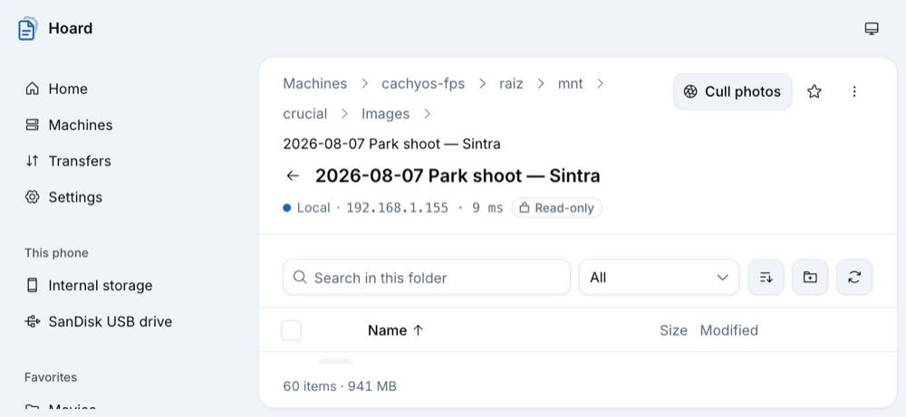      | 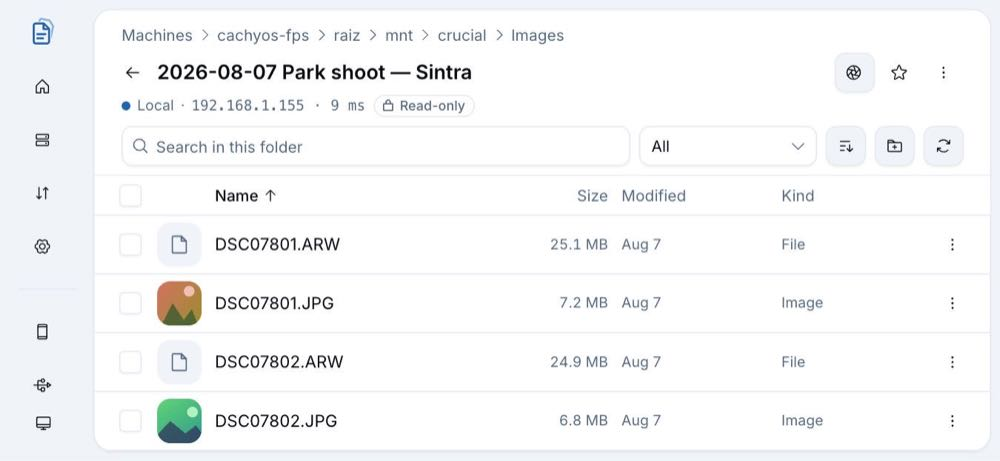      |
| 900×415, scrolled      | 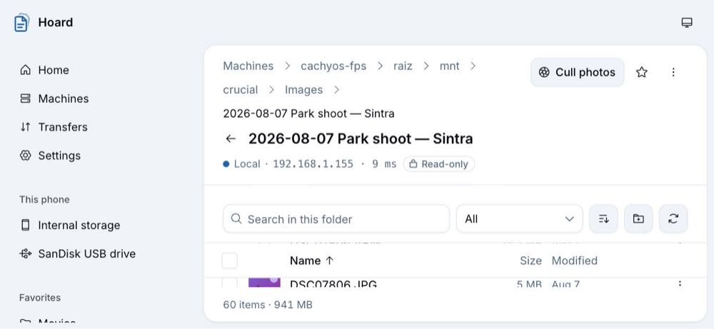 | 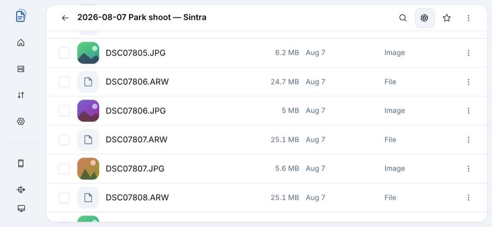 |
| 900×415 dark, scrolled | 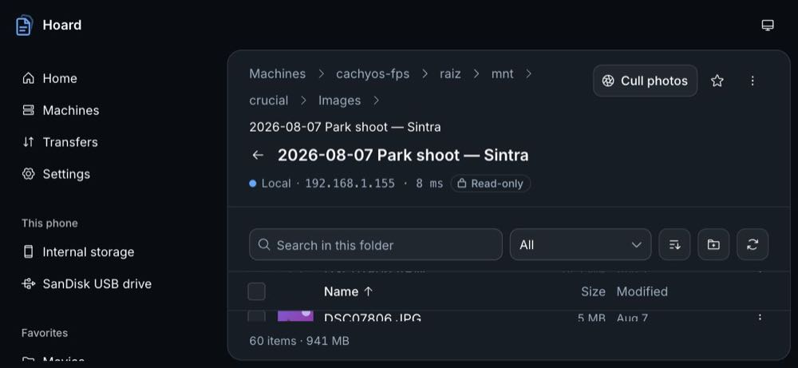  | 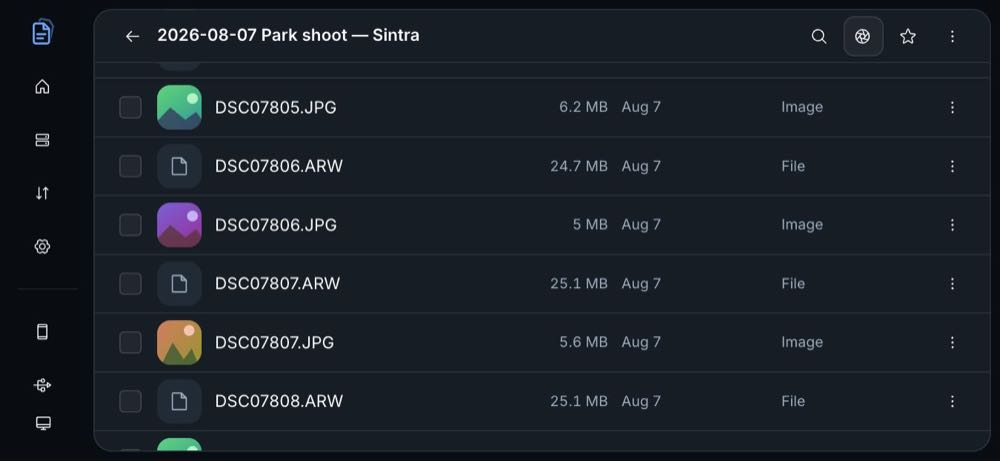  |
| Culling, 900×415       | 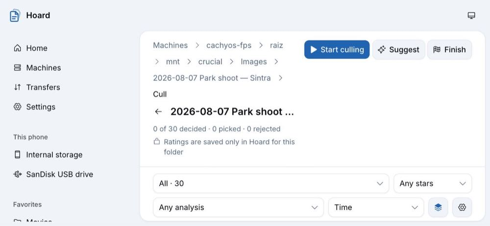          | 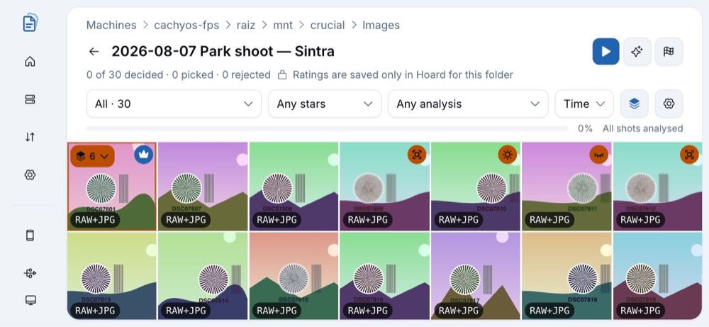          |
| 390×844, top           | 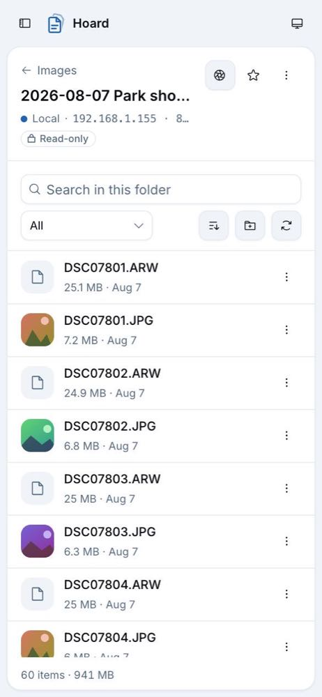      | 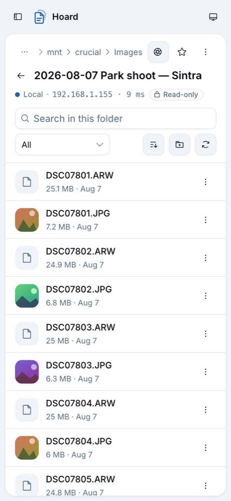      |
| 390×844, scrolled      | 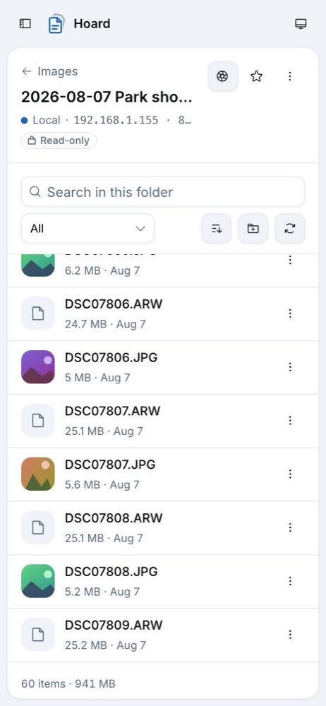 | 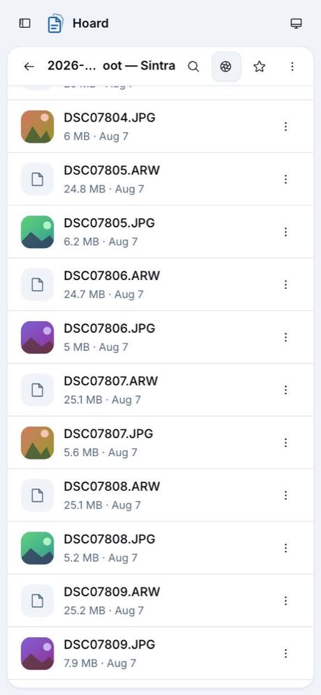 |

Emulator: 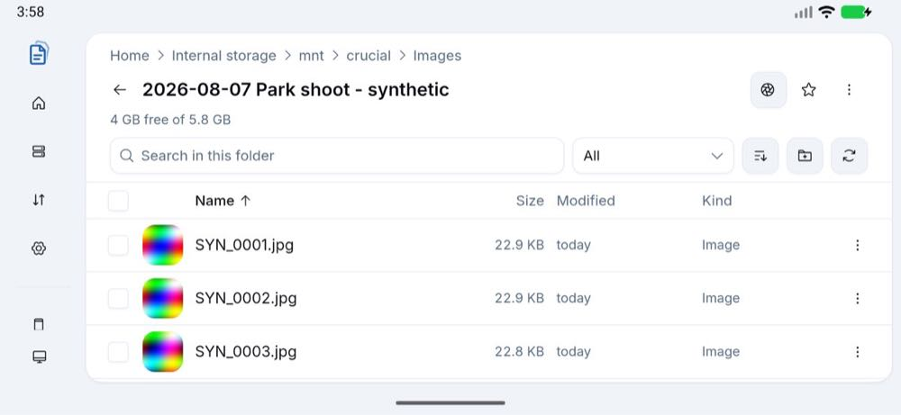 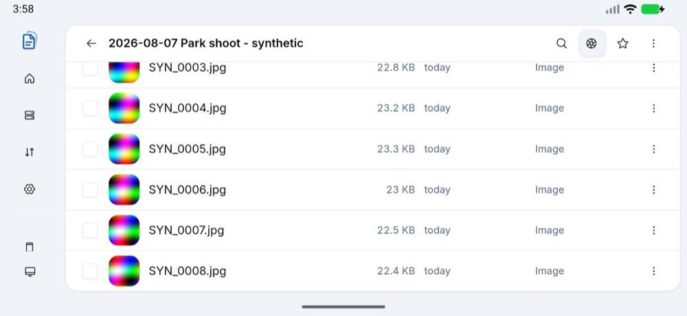
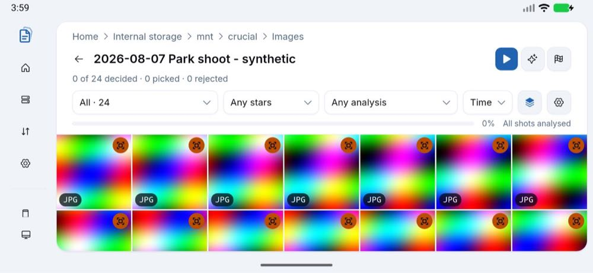 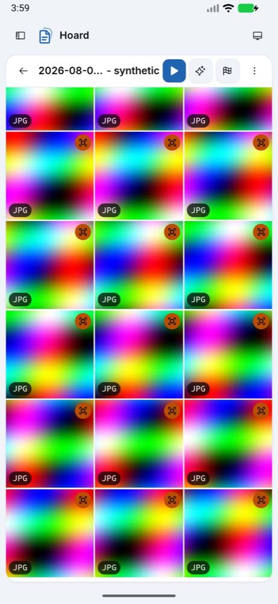

## Reproduce

The capture script lives outside the repo (Playwright driving the dev server); the steps: open each
screen with `localStorage["hoard.mock.storageAccess"] = "granted"`, screenshot, `mouse.wheel` 6×100
over the list, screenshot, 2×−40, screenshot. On a device, drive the WebView over CDP
(`docs/testing/tools/cdp.mjs`): navigate with `history.pushState` + a `popstate` event (a full
`location.assign` reloads to a blank WebView), rotate with `settings put system user_rotation 1`,
scroll with `adb shell input swipe`.
