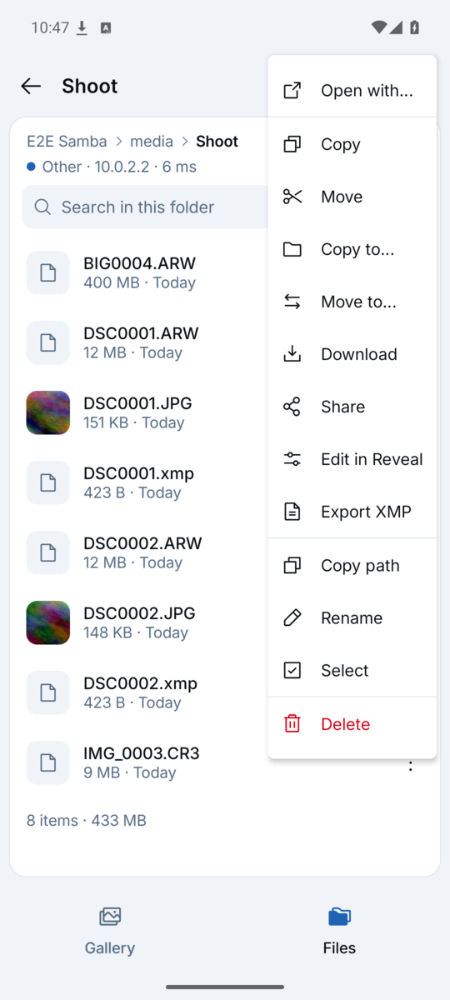
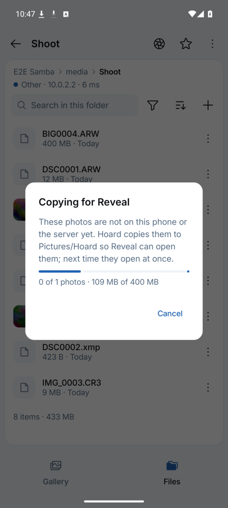
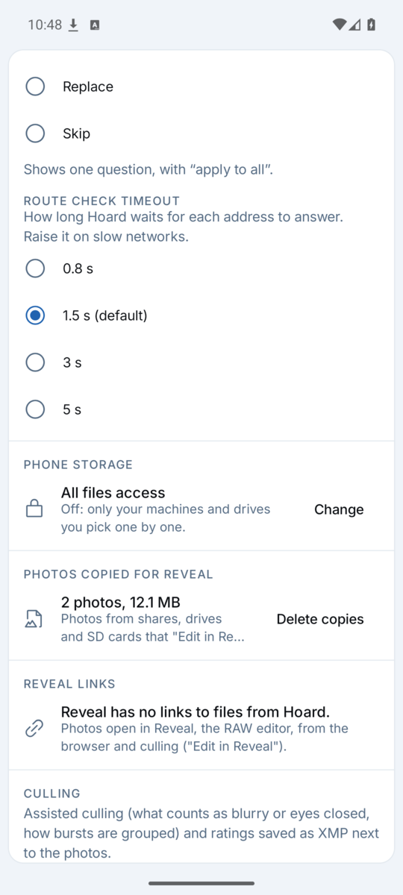
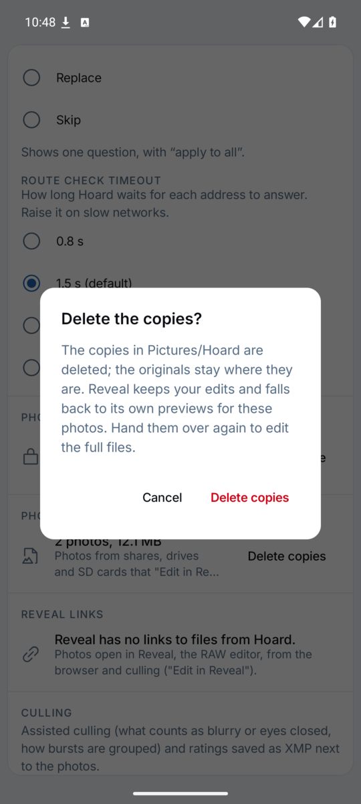
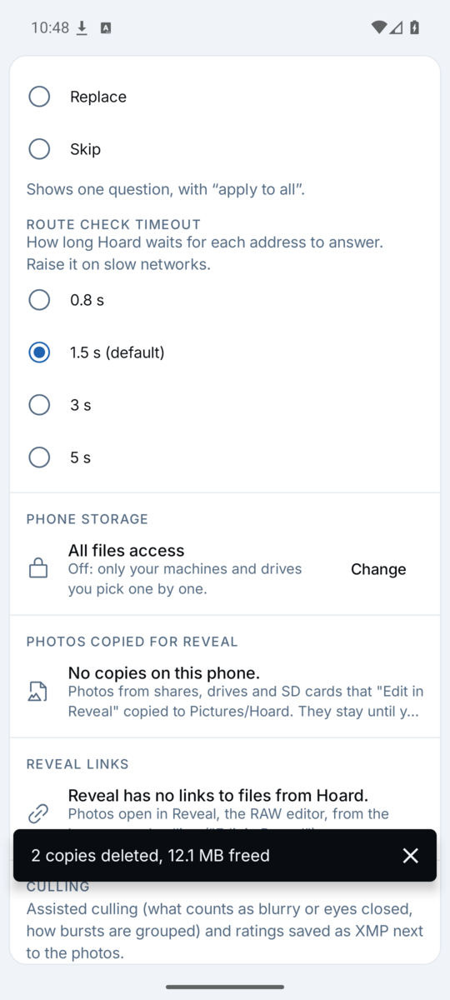

# Hand-off by local copy, no automatic XMP (Hoard 2.2.0)

End-to-end check of ADR 0010 amendment "2.2.0: local copies, no streaming for new hand-offs" and ADR 0011 amendment
"2.2.0: export on demand", 2026-11-15, on cachyos-fps.

## Setup

- Emulator `hoard-localcopy` (Pixel 8, Android 16 `BE2A.250530.026.D1`, Google Play image), `-memory 2048 -no-window`,
  port 5580. Fresh install of this branch's debug build (`dev.hfps.hoard`).
- A Samba container of our own (`docs/testing/samba/Dockerfile`, `127.0.0.1:4471`, user `hoard`), share `media`,
  folder `Shoot` with synthetic files: `DSC0001.ARW` + `DSC0001.JPG` (12 MB random with a TIFF header + a real JPEG),
  the same for `DSC0002`, `IMG_0003.CR3` (9 MB, ISO-BMFF `crx ` header), `BIG0004.ARW` (400 MB, for Cancel). No real
  photos.
- A test receiver standing in for Reveal: `docs/testing/mediastore-raw-probe/receiver` (application id
  `dev.hfps.reveal.debug`, versionCode 90000, answers `DEVELOP`). It logs (`adb logcat -s RevealProbe`) the extras and
  flags, then for each ClipData URI reads every byte, tries `takePersistableUriPermission` and opens it for writing.
  Never install it next to a real Reveal debug build.
- `LocalCopyHandoffE2eTest` (`native/src/androidTest`, opt-in `-e hoardLocalCopyE2e true`): adds a machine for the
  container (GUID pinned), then drives the real code: `FileActions.editInReveal` (the same call the Files and culling
  screens make), the transfer engine and WorkManager, MediaStore, `CullViewModelFactory`, `XmpExporter`,
  `RevealCopies`.

```sh
docker build -t hoard-smb-localcopy docs/testing/samba
docker run -d --rm --name hoard-smb-localcopy --memory 512m --cpus 1 -p 127.0.0.1:4471:445 hoard-smb-localcopy
docker cp <files>/. hoard-smb-localcopy:/srv/media/Shoot/ && docker exec hoard-smb-localcopy chown -R hoard /srv/media/Shoot
cd android && ./gradlew :native:assembleDebug :native:assembleDebugAndroidTest
adb -s emulator-5580 install -r -g native/build/outputs/apk/debug/native-debug.apk
adb -s emulator-5580 install -r -g native/build/outputs/apk/androidTest/debug/native-debug-androidTest.apk
adb -s emulator-5580 install -r ../docs/testing/mediastore-raw-probe/receiver/build/outputs/apk/debug/receiver-debug.apk
adb -s emulator-5580 shell am instrument -w -r -e class dev.hfps.hoard.app.LocalCopyHandoffE2eTest \
  -e hoardLocalCopyE2e true -e port 4471 dev.hfps.hoard.test/androidx.test.runner.AndroidJUnitRunner
```

(`am instrument` on purpose: `connectedAndroidTest` uninstalls the app.)

## Results

| Step | Result |
| --- | --- |
| Edit in Reveal of `DSC0001.ARW`, `DSC0001.JPG`, `IMG_0003.CR3` (none on the server) | 3 photos sent; **one** transfer job (`mediastore` destination), 14 progress events, ended `completed 3/3 22174442/22174442` |
| Where the copies went | `Pictures/Hoard/E2E Trip/DSC0001.ARW` (`image/x-sony-arw`, `images/media/44`), `…/DSC0001.JPG` (`image/jpeg`), `Download/Hoard/E2E Trip/IMG_0003.CR3` (`application/octet-stream`, `downloads/46`); all `IS_PENDING = 0`, sizes equal to the sources |
| `reveal_copies` | 3 rows: source `Shoot/…`, size and mtime of the source, the MediaStore URI |
| What the receiver got | `DEVELOP`, `TITLE=E2E Trip`, `INITIAL_URI` = the ARW's copy, `CULLING_VERSION=2` keyed by the `content://media/…` URIs (`rating=4 flag=pick`, `*ModifiedAt`), no server items, no batch extras; flags **read=true write=false persistable=false**; each item read in full (12582913, 154345, 9437184 bytes); `takePersistableUriPermission` → `SecurityException`; open for writing → `RecoverableSecurityException` (Images) / `SecurityException` (Downloads); no sidecar item |
| Same three photos again | **0** new transfer jobs, the same three URIs (reused by path + size + mtime) |
| Cancel during the copy of `BIG0004.ARW` (at 1 MiB of 400 MiB) | the hand-off ends cancelled (no intent); 4 s later **0** rows under `Hoard/E2E Cancel/` in Images or Downloads, pending ones included; nothing recorded |
| Culling on the share: `dsc0002` rejected then rated 1 (a pick with one star, the culling rule) | saved in Hoard; `.xmp` on the share afterwards: **none** |
| Export XMP of the folder | `written=2` (`DSC0001.xmp` pick ★4, `DSC0002.xmp` pick ★1, `xmp:CreatorTool="Hoard 2.2.0"`), on the share |
| Settings › Photos copied for Reveal before / Delete copies / after | `3 photos, 22174442 B` → `3 deleted, 22174442 B` → `0, 0`; the probe apps' rows in `Pictures/Hoard/` (another owner) untouched |

### By hand, in the UI




Cancel in the dialog stopped the 400 MB copy (no copy left). Edit in Reveal on `DSC0001.ARW` copied the pair and the
receiver got both URIs (read only, CULLING v2). Settings showed the copies and deleted them:





## Not verified

- A real Reveal 0.9.0 receiving these hand-offs (including copying the Downloads CR3 into its own storage), and its
  fallback to its previews after Delete copies.
- USB drives, SD cards and SAF folders as sources (the same code path as SMB: `RevealCopies` with the location's
  transfer endpoint), and a phone photo going by its own MediaStore URI (`RevealCopies.onPhone`, JVM-tested only).
- Export XMP into a SAF-picked folder for a read-only share (`DocumentTransferFs`; the read-only stop is JVM-tested).
- The upgrade from 2.1 forcing `cullSaveXmp` off on a real install (`MigrationTest` and `RevealRoutesTest` cover the
  migration and the start-up step).
- Android 10–15 and real RAW files (see `mediastore-raw.md`).
