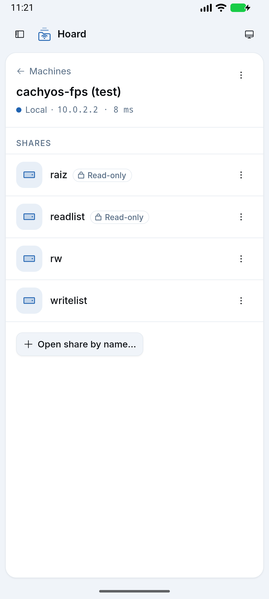
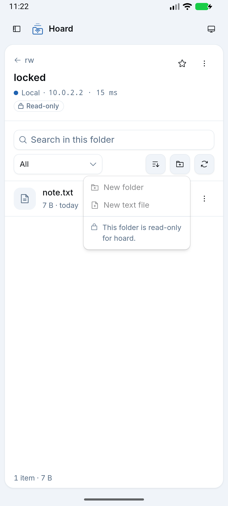
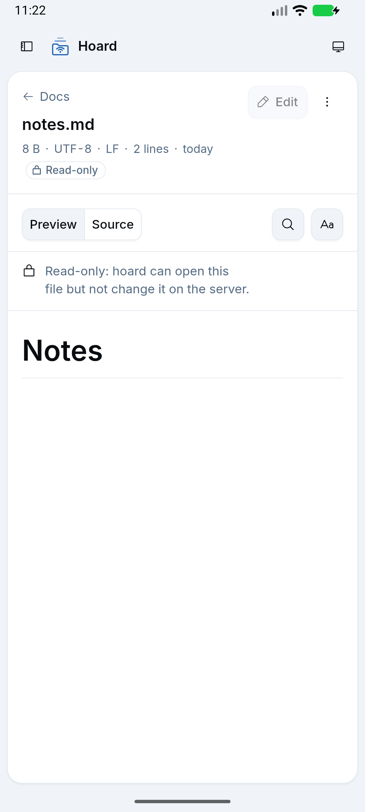
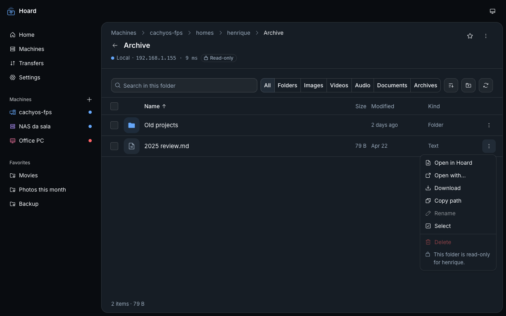

# Read-only shares and folders (1.2.0)

Owner feedback: most Samba shares on cachyos-fps are `read only = yes` (e.g. `raiz`), and nothing
in the app said so until creating a folder or file failed. 1.2.0 shows a quiet **Read-only** badge
on such shares and folders and disables (does not hide) the write actions there.

## How access is detected

Only from what the server answers, never from names or failed writes (ADR 0001, "Read-only shares
and folders"):

| Level         | Source                                                                                                                          |
| ------------- | ------------------------------------------------------------------------------------------------------------------------------- |
| Share         | TREE_CONNECT response `MaximalAccess` (one tree connect per share in `listShares`, 4 at a time, 4 s budget, failures → unknown) |
| Folder        | "MxAc" create context on the CREATE that `SmbBrowser.listDirectory` sends to list it                                            |
| File (viewer) | "MxAc" on the CREATE that `readTextFile` sends to read it                                                                       |

`readWrite` = the mask has any of FILE_WRITE_DATA / ADD_FILE (0x2), FILE_APPEND_DATA /
ADD_SUBDIRECTORY (0x4), FILE_DELETE_CHILD (0x40), GENERIC_ALL, GENERIC_WRITE; otherwise `read`; no
usable mask (none, 0, MAXIMUM_ALLOWED alone) = unknown. A share-level `read` wins over the folder.
Tested in `SmbAccessTest` (JVM unit test).

ShareFlags were not needed: smbj does not expose them (only the encrypt flag is used internally),
and Samba already reports `read only` in the maximal access.

## Empirical results

`SmbAccessProbeTest` (opt-in) prints every share's tree mask and every top-level folder's MxAc
answer; with `HOARD_ACCESS_WRITE_PROBE=1` (disposable servers only) it also creates and deletes a
folder everywhere and fails if the detected access disagrees.

### Samba 4.20 (`docs/testing/samba-access/Dockerfile`), with the write probe

    docker build -t hoard-smb-access docs/testing/samba-access
    docker run -d --rm --name hoard-smb-access --memory 256m -p 127.0.0.1:14458:445 hoard-smb-access
    HOARD_SMOKE_ACCESS=127.0.0.1:14458 HOARD_SMOKE_USER=hoard HOARD_SMOKE_PASSWORD=hoardpass \
      HOARD_ACCESS_WRITE_PROBE=1 ./gradlew testDebugUnitTest --tests '*SmbAccessProbeTest*'

| Share / folder                                       | Tree MaximalAccess | MxAc         | Detected  | Real write |
| ---------------------------------------------------- | ------------------ | ------------ | --------- | ---------- |
| `raiz` (`read only = yes`)                           | `0x001f00a9`       | `0x000c00a9` | read      | denied     |
| `raiz/Docs`                                          |                    | `0x000c00a9` | read      | denied     |
| `readlist` (`read only = no`, `read list` = user)    | `0x001f00a9`       | `0x000c00a9` | read      | denied     |
| `writelist` (`read only = yes`, `write list` = user) | `0x001f01ff`       | `0x001f01ff` | readWrite | allowed    |
| `rw` (`read only = no`)                              | `0x001f01ff`       | `0x001f01ff` | readWrite | allowed    |
| `rw/locked` (root-owned, mode 0555)                  |                    | `0x001300a9` | read      | denied     |
| `rw/open`                                            |                    | `0x001f01ff` | readWrite | allowed    |

Files through `readTextFile`: `raiz/readme.txt` read, `rw/readme.txt` readWrite,
`rw/locked/note.txt` (0444) read.

Samba's maximal access on a read-only share is **not** generous for write data, but it does keep
DELETE, WRITE_DAC and WRITE_OWNER (`0x001f00a9` at tree level, `0x000c00a9` on folders). That is
why those rights do not count as "writable". `read list` / `write list` are reflected too.
`listShares` with the four tree connects took about 350 ms on the JVM (4 shares).

### macOS 26 File Sharing (owner's Mac, read-only: no write probe)

    skv run hoard -- sh -c 'HOARD_SMOKE_ACCESS=127.0.0.1:445 HOARD_SMOKE_USER="$MAC_SMB_USER" \
      HOARD_SMOKE_PASSWORD="$MAC_SMB_PASSWORD" ./gradlew testDebugUnitTest --tests "*SmbAccessProbeTest*"'

| Share / folder                                                              | Tree MaximalAccess | MxAc         | Detected  |
| --------------------------------------------------------------------------- | ------------------ | ------------ | --------- |
| home share                                                                  | `0x001f01ff`       | `0x001f01ff` | readWrite |
| `Macintosh HD/` (root, root:wheel 755)                                      | `0x001f01ff`       | `0x001200a9` | read      |
| `Macintosh HD/System`, `/Users`, `/usr`, `/Library`, …                      |                    | `0x001200a9` | read      |
| `Macintosh HD/Applications` (admin group writable; the account is an admin) |                    | `0x001f01ff` | readWrite |
| `StorageExtension/` and its folders                                         | `0x001f01ff`       | `0x001f01ff` | readWrite |

macOS always grants full access at share level and enforces POSIX permissions per item, so the
folder-level MxAc answer is what tells read-only folders apart. It matches the filesystem
permissions above. (Folder names in the home share are left out: this repository is public.)

### Windows

No Windows server was available for this run. Windows answers TREE_CONNECT with the share
permission's mask and MxAc with the NTFS ACL's effective rights, the same two sources, so share
"Read" permissions and read-only NTFS folders follow the same rule (Windows "Read & execute" is
`0x001200a9` → read, covered by `SmbAccessTest`).

## In the app (debug build, emulator `hoard-readonly`, Samba at `10.0.2.2:14458`)

The raw plugin calls over CDP returned the same answers as the table (`listShares` access per
share, `list` access for `rw`, `rw/locked`, `rw/open`, `raiz`, `raiz/Docs`, `readlist`,
`writelist`, `readTextFile` access for files) and `createFolder` in `raiz` still rejected
`ACCESS_DENIED`. Against the Mac from the emulator: `listShares` with access in 177 ms;
`Macintosh HD/` read, `/Applications` readWrite.

| Shares                              | Read-only folder, New menu                        | Text viewer on a read-only share    |
| ----------------------------------- | ------------------------------------------------- | ----------------------------------- |
|  |  |  |

Desktop, dark (web mock): a read-only folder on a writable share, row menu with Rename and Delete
disabled and the reason under them.

## UI rules

- Share rows: outline badge with a lock, muted, only on read-only shares (writable is the norm).
- Folder header: the same badge next to the route status; it wraps under it on phones.
- New folder / New text file (toolbar menu and empty state), Rename, Delete (row menu and
  selection bar), Edit in the viewer: disabled, still visible. Menus carry the reason as a label
  ("This folder is read-only for hoard."), since tooltips do not show on touch or on disabled
  items; the viewer shows a notice and opens read-only even when asked to edit.
- Unknown access leaves everything enabled; a write the server refuses still shows its error.
