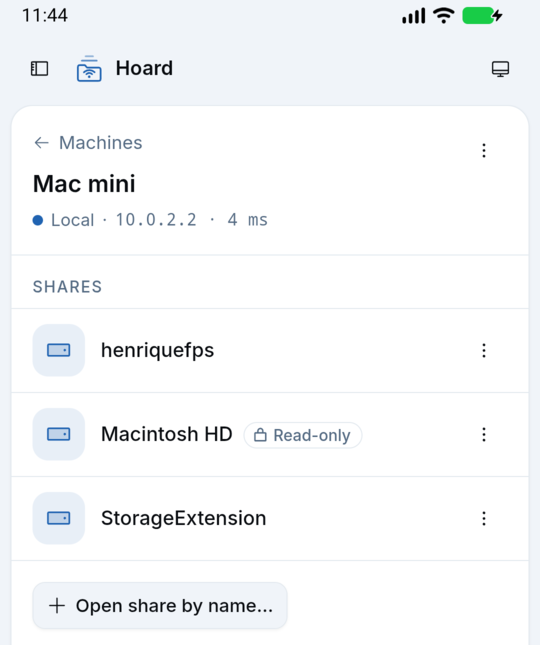
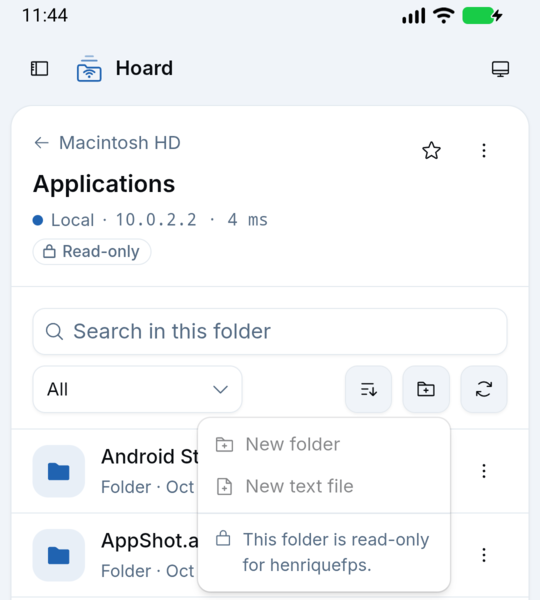

# Read-only shares and folders (1.2.0, macOS fix in 1.2.1)

Owner feedback: most Samba shares on cachyos-fps are `read only = yes` (e.g. `raiz`), and nothing
in the app said so until creating a folder or file failed. 1.2.0 shows a quiet **Read-only** badge
on such shares and folders and disables (does not hide) the write actions there.

## How access is detected

Only from what the server answers, never from names or failed writes (ADR 0001, "Read-only shares
and folders"):

| Level         | Source                                                                                                                                                                                       |
| ------------- | -------------------------------------------------------------------------------------------------------------------------------------------------------------------------------------------- |
| Share         | TREE_CONNECT response `MaximalAccess` (one tree connect per share in `listShares`, 4 at a time, 4 s budget, failures → unknown), and since 1.2.1 the share's security descriptor (see below) |
| Folder        | "MxAc" create context on the CREATE that `SmbBrowser.listDirectory` sends to list it, and since 1.2.1 the write probe on that same CREATE (FILE_ADD_FILE)                                    |
| File (viewer) | "MxAc" on the CREATE that `readTextFile` sends to read it, and since 1.2.1 the write probe on it (FILE_WRITE_DATA)                                                                           |

`readWrite` = the mask has any of FILE_WRITE_DATA / ADD_FILE (0x2), FILE_APPEND_DATA /
ADD_SUBDIRECTORY (0x4), FILE_DELETE_CHILD (0x40), GENERIC_ALL, GENERIC_WRITE; otherwise `read`; no
usable mask (none, 0, MAXIMUM_ALLOWED alone) = unknown. A share-level `read` wins over the folder.
Tested in `SmbAccessTest` (JVM unit test).

### 1.2.1: macOS read-only shares

macOS File Sharing ignores its own per-share "read-only" flag in both answers above: TREE_CONNECT
says full access (`0x001f01ff`) and MxAc follows only the POSIX permissions. On the owner's Mac
`sharing -l` lists `Macintosh HD` (path `/`) with `read-only: 1`, so 1.2.0 called every folder
the account owns there (`/Users/<user>`, `/Applications` for an admin, `/Volumes/…`) writable, and
New folder etc. failed. Two more answers, neither of which writes anything:

- **Write probe** (`AccessProbe` in `SmbSessions.kt`, decision `SmbAccess.decide`): the CREATE that
  lists a folder also asks for FILE_ADD_FILE (FILE_WRITE_DATA on the CREATE that reads a text file).
  Granted → writable, with no extra round trip. Refused with STATUS_ACCESS_DENIED or
  STATUS_MEDIA_WRITE_PROTECTED → read-only, and the CREATE is sent again without the write right
  (one extra round trip, only on read-only items). Any other refusal (sharing violation, …) says
  nothing and MxAc decides as before; a missing item fails at once. A folder found read-only is
  remembered for 60 s per session + share + path (`ReadOnlyHints`), so listing it again costs
  nothing extra. The handle is only read from and closed: no SET_INFO, no WRITE.
- **Share security descriptor** (`ShareSecurity.kt`): `listShares` asks NetrShareEnum for level
  502 instead of 1 (level 1 again on the same pipe when refused). macOS sends each share's
  descriptor: Everyone `0x00120089` (read) on `Macintosh HD`, `0x001f01ff` on `StorageExtension`,
  plus a null-SID deny that matches nobody. It is only evaluated when every ACE names Everyone or
  the null SID (true for any account); an ACE for any other SID (the home share's single ACE for
  the user, Windows' Administrators) gives no answer. Samba answers level 502 to a normal user
  but without descriptors, so nothing changes there. This is what puts the badge on the
  `Macintosh HD` row: its root is root-owned 755, so the folder probe alone could not tell the
  share's flag from POSIX.

Neither replaces the other: the descriptor answers the shares list without opening anything, the
probe answers every folder and file even when the share was opened by name or the server keeps
its descriptors to itself.

ShareFlags were not needed: smbj does not expose them (only the encrypt flag is used internally),
and Samba already reports `read only` in the maximal access.

## Empirical results

`SmbAccessProbeTest` (opt-in) prints every share's tree mask and descriptor answer and every
top-level folder's MxAc and write-probe answers (`HOARD_ACCESS_PATHS='share|path;…'` adds deeper
folders and files); with `HOARD_ACCESS_WRITE_PROBE=1` (disposable servers only) it also creates and
deletes a folder everywhere and fails if the detected access disagrees. Pass `--rerun`: Gradle does
not see environment changes and would otherwise skip the test as up to date.

### Samba 4.20 (`docs/testing/samba-access/Dockerfile`), with the write probe

    docker build -t hoard-smb-access docs/testing/samba-access
    docker run -d --rm --name hoard-smb-access --memory 256m -v hoard-srv:/srv \
      -p 127.0.0.1:14458:445 hoard-smb-access
    HOARD_SMOKE_ACCESS=127.0.0.1:14458 HOARD_SMOKE_USER=hoard HOARD_SMOKE_PASSWORD=hoardpass \
      HOARD_ACCESS_WRITE_PROBE=1 ./gradlew testDebugUnitTest --rerun --tests '*SmbAccessProbeTest*'
    docker rm -f hoard-smb-access && docker volume rm hoard-srv

(`-v hoard-srv:/srv` puts the fixture on a real filesystem; see "Does the probe change anything"
below for why that matters when checking timestamps.)

| Share / folder                                       | Tree MaximalAccess | MxAc         | Write probe (1.2.1) | Detected  | Real write |
| ---------------------------------------------------- | ------------------ | ------------ | ------------------- | --------- | ---------- |
| `raiz` (`read only = yes`)                           | `0x001f00a9`       | `0x000c00a9` | denied              | read      | denied     |
| `raiz/Docs`                                          |                    | `0x000c00a9` | denied              | read      | denied     |
| `readlist` (`read only = no`, `read list` = user)    | `0x001f00a9`       | `0x000c00a9` | denied              | read      | denied     |
| `writelist` (`read only = yes`, `write list` = user) | `0x001f01ff`       | `0x001f01ff` | granted             | readWrite | allowed    |
| `rw` (`read only = no`)                              | `0x001f01ff`       | `0x001f01ff` | granted             | readWrite | allowed    |
| `rw/locked` (root-owned, mode 0555)                  |                    | `0x001300a9` | denied              | read      | denied     |
| `rw/open`                                            |                    | `0x001f01ff` | granted             | readWrite | allowed    |

Samba's descriptor answer is unknown for every share (level 502 without descriptors), so the share
column is unchanged from 1.2.0. The probe agrees with MxAc everywhere on Samba; 1.2.1 changes no
Samba answer.

Files through `readTextFile`: `raiz/readme.txt` read, `rw/readme.txt` readWrite,
`rw/locked/note.txt` (0444) read.

Samba's maximal access on a read-only share is **not** generous for write data, but it does keep
DELETE, WRITE_DAC and WRITE_OWNER (`0x001f00a9` at tree level, `0x000c00a9` on folders). That is
why those rights do not count as "writable". `read list` / `write list` are reflected too.
`listShares` with the four tree connects took about 350 ms on the JVM (4 shares).

### macOS 26 File Sharing (owner's Mac, read-only: no write probe)

    skv run hoard -- sh -c 'HOARD_SMOKE_ACCESS=127.0.0.1:445 HOARD_SMOKE_USER="$MAC_SMB_USER" \
      HOARD_SMOKE_PASSWORD="$MAC_SMB_PASSWORD" ./gradlew testDebugUnitTest --rerun --tests "*SmbAccessProbeTest*"'

Shares on that Mac (`sharing -l`): `Macintosh HD` (`/`, **read-only: 1**), `StorageExtension`
(`/Volumes/StorageExtension`, read-only: 0), the home share and the Public folder (read-only: 0).

1.2.0, from the run below (the table as first recorded, before the share flag was known):

| Share / folder                                                              | Tree MaximalAccess | MxAc         | Detected  |
| --------------------------------------------------------------------------- | ------------------ | ------------ | --------- |
| home share                                                                  | `0x001f01ff`       | `0x001f01ff` | readWrite |
| `Macintosh HD/` (root, root:wheel 755)                                      | `0x001f01ff`       | `0x001200a9` | read      |
| `Macintosh HD/System`, `/Users`, `/usr`, `/Library`, …                      |                    | `0x001200a9` | read      |
| `Macintosh HD/Applications` (admin group writable; the account is an admin) |                    | `0x001f01ff` | readWrite |
| `StorageExtension/` and its folders                                         | `0x001f01ff`       | `0x001f01ff` | readWrite |

macOS always grants full access at tree level and MxAc follows the POSIX permissions only, which
is right for `StorageExtension` but wrong for `Macintosh HD`: `/Applications` came out readWrite
on a read-only share, and so did `/Users/<user>` (MxAc `0x001f01ff`; not listed above, the 1.2.0
probe only looked one level down). (Folder names in the home share are left out: this repository
is public.)

1.2.1, same Mac, same harness plus `HOARD_ACCESS_PATHS`:

| Share / folder or file                                         | Tree         | Descriptor | MxAc         | Write probe | Detected 1.2.0 | Detected 1.2.1 |
| -------------------------------------------------------------- | ------------ | ---------- | ------------ | ----------- | -------------- | -------------- |
| `Macintosh HD` (share)                                         | `0x001f01ff` | read       |              |             | readWrite      | **read**       |
| `Macintosh HD/` and `/System`, `/Users`, `/usr`, `/Library`, … |              |            | `0x001200a9` | denied      | read           | read           |
| `Macintosh HD/Applications`                                    |              |            | `0x001f01ff` | denied      | readWrite      | **read**       |
| `Macintosh HD/Users/<user>`, `/Users/<user>/Documents`         |              |            | `0x001f01ff` | denied      | readWrite      | **read**       |
| file `Macintosh HD/Volumes/StorageExtension/README.md`         |              |            |              | denied      | readWrite      | **read**       |
| `StorageExtension` (share)                                     | `0x001f01ff` | readWrite  |              |             | readWrite      | readWrite      |
| `StorageExtension/` and its folders                            |              |            | `0x001f01ff` | granted     | readWrite      | readWrite      |
| file `StorageExtension/README.md` (the same file)              |              |            |              | granted     | readWrite      | readWrite      |
| home share                                                     | `0x001f01ff` | unknown    | `0x001f01ff` | granted     | readWrite      | readWrite      |

Neither the TREE_CONNECT share flags (no read-only flag exists in SMB2) nor the volume's
FileFsAttributeInformation (`0x010400c6`, FILE_READ_ONLY_VOLUME clear on both shares) tell the
read-only share apart; only the descriptor and the probe do.

### Does the probe change anything?

No, checked with `stat -f '%Fa %Fm %Fc %FB'` (atime, mtime, ctime, birth), mode, flags, an
`xattr -l` hash and a directory-listing hash before and after each run:

- **Mac, read-only share**: `/`, `/Users/<user>`, `/Users/<user>/Documents`, `/Applications`, and
  the file reached through `Macintosh HD`: refused, nothing changed.
- **Mac, writable share**: two folders on `StorageExtension` opened with FILE_WRITE_ATTRIBUTES and
  with FILE_ADD_FILE, and `README.md` opened with FILE_WRITE_DATA: granted, closed, nothing
  changed (same nanosecond timestamps). The full harness, the CDP run from the emulator left
  everything as it was (a home-share file the harness read still had its months-old ctime).
- **Samba on a real filesystem** (`/srv` on a btrfs volume): every file and folder of the fixture
  identical before and after the harness and the emulator run.
- **Samba with `/srv` in the image (overlayfs)**: in two of five runs the first write-capable open
  of a file whose write probe was granted (`rw/readme.txt`, `writelist/readme.txt`) bumped the
  ctime of that file, its folder and `/srv` (mtime, content and xattrs unchanged, nothing after
  the first time). Plain reads with `smbclient` did not. This is the overlay filesystem
  (write-capable opens of lower-layer files) and does not happen on a real filesystem; it is why
  the fixture now runs on a volume.

A granted FILE_WRITE_DATA open does make the server open the file for writing, so local watchers
on the server may see a close-after-write event (inotify `IN_CLOSE_WRITE`) for a file opened in
the viewer, with nothing changed. Folders are opened read-only by the server either way.

### Windows

No Windows server was available for this run. Windows answers TREE_CONNECT with the share
permission's mask and MxAc with the NTFS ACL's effective rights, the same two sources, so share
"Read" permissions and read-only NTFS folders follow the same rule (Windows "Read & execute" is
`0x001200a9` → read, covered by `SmbAccessTest`).

## In the app (debug build, emulator `hoard-readonly`, Samba at `10.0.2.2:14458`)

The raw plugin calls over CDP returned the same answers as the table (`listShares` access per
share, `list` access for `rw`, `rw/locked`, `rw/open`, `raiz`, `raiz/Docs`, `readlist`,
`writelist`, `readTextFile` access for files) and `createFolder` in `raiz` still rejected
`ACCESS_DENIED`. Against the Mac from the emulator: `listShares` with access in 177 ms;
`Macintosh HD/` read, `/Applications` readWrite (wrong, fixed in 1.2.1).

1.2.1, emulator `hoard-macro` (debug build), raw plugin calls over CDP:

- Mac (`10.0.2.2:445`): `listShares` → `Macintosh HD=read`, `StorageExtension=readWrite` (545 ms,
  first call after the app started); `list` → `Macintosh HD/` read, `/Users/<user>` read, `/Users/<user>/Documents` read,
  `/Applications` read twice (the second time from the 60 s hint: an earlier build answered
  readWrite there, because skipping the probe left MxAc alone to decide; fixed and unit tested),
  `StorageExtension/` and `/CocoaPods` readWrite; `readTextFile` of the same `README.md` → read
  through `Macintosh HD`, readWrite through `StorageExtension`. Folder listings took 15–143 ms (405 ms for the first, cold one). No
  writes were attempted on the Mac; `stat` of every path above was identical before and after.
- Samba (`10.0.2.2:14458`): `raiz`, `readlist` read, `rw`, `writelist` readWrite; `raiz/`,
  `raiz/Docs` (twice), `readlist/`, `rw/locked` (twice) read; `writelist/`, `rw/`, `rw/open`
  readWrite; `readTextFile` `raiz/readme.txt` read, `rw/readme.txt` readWrite,
  `rw/locked/note.txt` read; `createFolder` in `raiz` still `ACCESS_DENIED`, in `rw/open` created
  and deleted.

| Mac shares (1.2.1)                      | `Macintosh HD/Applications`, New menu (1.2.1)       |
| --------------------------------------- | --------------------------------------------------- |
|  |  |

| Shares                              | Read-only folder, New menu                        | Text viewer on a read-only share    |
| ----------------------------------- | ------------------------------------------------- | ----------------------------------- |
|  |  |  |

Desktop, dark (web mock): a read-only folder on a writable share, row menu with Rename and Delete
disabled and the reason under them.

## UI rules

- Share rows: outline badge with a lock, muted, only on read-only shares (writable is the norm).
- Folder header: the same badge next to the route status; it wraps under it on phones.
- New folder / New text file (toolbar menu and empty state), Rename, Delete (row menu and
  selection bar), Edit in the viewer: disabled, still visible. Menus carry the reason as a label
  ("This folder is read-only for hoard."), since tooltips do not show on touch or on disabled
  items; the viewer shows a notice and opens read-only even when asked to edit.
- Unknown access leaves everything enabled; a write the server refuses still shows its error.
