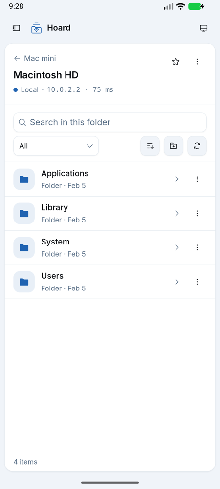
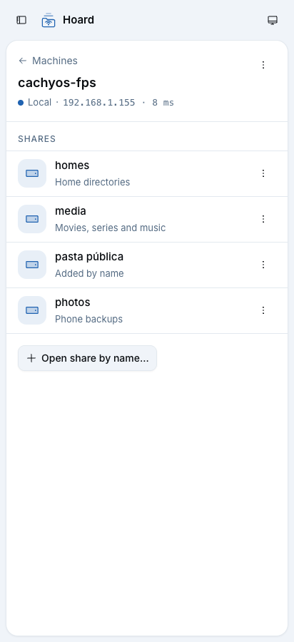

# Shares on macOS all showed the same folder

Bug report (1.0.0, Samsung S24 Ultra, a Mac with macOS 26 File Sharing): the Mac's shares
`henriquefps`, `Macintosh HD` and `StorageExtension` all listed the contents of whichever share was
opened first on the connection.

## Root cause

smbj 0.15.0 added SMB3 **directory leasing**. When the server advertises
`SMB2_GLOBAL_CAP_DIRECTORY_LEASING` (macOS smbd, Windows; Samba only with
`smb3 directory leases = yes`), `DiskShare.list(path, …)` and `DiskShare.openDirectory(…)` go through
the connection-wide `LeaseManager`, whose lease keys and `LeasedDirectoryCache` are looked up by
`SmbPath.getPath()`: the path **inside** the share, without host, share or tree id. After share A's
root (`""`) was listed under a read-handle lease, listing the root of share B on the same
connection was answered from A's cache without any request reaching the server. Any path that
exists in both shares (`Library`, `Applications`, …) collided the same way. A fresh connection
always listed correctly, so the bug looked random: whichever share was opened first after the
app (re)connected "won".

How it was found: a logging TCP proxy between the JVM harness and the Mac (signed SMB3 is
readable) showed three TREE_CONNECTs with distinct tree ids (1, 2, 3), but only **one** CREATE +
QUERY_DIRECTORY, on tree 1. The second and third listings never left the client. Ruled out on the
way: TreeId reuse, smbj's tree-connect cache, the IPC$ connect/disconnect of `listShares`,
share-name encoding, DFS, separate SMB sessions on one connection (the cache is per connection),
and the UI (React keys, the folder cache by machine + share + path).

## Fix

`SmbBrowser.listDirectory` opens the folder with a plain CREATE (`FILE_DIRECTORY_FILE`, no lease
context) and runs QUERY_DIRECTORY on that handle, so every listing comes from the server.
`SmbBrowser.list` and the recursive delete (`deleteTree`, which could otherwise have walked another
share's listing) both use it. `DirectoryListingGuardTest` fails the default unit test run if
`DiskShare.list`/`openDirectory` is called again.

## Evidence

`SmbMultiShareTest` (opt-in, read-only): one connection enumerates the shares and lists every
share's root and the folder names common to several shares, in forward, reverse and forward
order, comparing each listing with one taken on a fresh connection.

Against the Mac (`127.0.0.1:445`, entry counts only; this repo is public):

| listing (forward order)         | before (1.0.0)     | after                 |
| ------------------------------- | ------------------ | --------------------- |
| `henriquefps/`                  | 186 entries        | 186 entries           |
| `Macintosh HD/`                 | 186 entries (home) | 21 entries            |
| `Macintosh HD/Applications`     | 7 entries (home)   | 51 entries            |
| `StorageExtension/`             | 186 entries (home) | 26 entries            |
| `StorageExtension/Applications` | 7 entries (home)   | `NOT_FOUND` (correct) |
| result                          | FAILED             | PASSED                |

Against Samba 4.23 with directory leases (`docs/testing/samba-leases/Dockerfile`; reproduces the
bug without a Mac):

    docker build -t hoard-smb-leases docs/testing/samba-leases
    docker run -d --rm --name hoard-smb-leases --memory 256m -p 127.0.0.1:14457:445 hoard-smb-leases
    HOARD_SMOKE_SHARES=127.0.0.1:14457 HOARD_SMOKE_USER=hoard HOARD_SMOKE_PASSWORD=hoardpass \
      ./gradlew testDebugUnitTest --tests '*SmbMultiShareTest*'

```
before:  forward  Macintosh HD/ -> 2 entries: [Shared, only-home.txt]       FAILED
         forward  StorageExtension/Shared -> 1 entries: [in-home.txt]
after:   forward  Macintosh HD/ -> 2 entries: [Shared, only-root.txt]       PASSED
         forward  StorageExtension/Shared -> 1 entries: [in-storage.txt]
         forward  Pasta Pública de Hoard/Shared -> <NOT_FOUND>
```

The existing `SmbIntegrationTest` (writes, recursive delete, errors) passes against
`docs/testing/samba`.

In the app (debug build, emulator, Mac at `10.0.2.2`): `henriquefps`, `Macintosh HD` and
`StorageExtension` each show their own folders on one session.



## Follow-up: the Public folder share never appears

The Mac also shares the user's Public folder (`sharing -l`: `smb shared: 1`, `guest access: 1`),
but Hoard listed only `henriquefps`, `Macintosh HD` and `StorageExtension`.

- **Not our decoding.** The raw NetrShareEnum reply (captured from `SrvSvc`, level 1, 300 bytes,
  status 0, `TotalEntries` 4) holds exactly `IPC$`, `Macintosh HD`, `StorageExtension` and
  `henriquefps`. `smbutil view //<user>@127.0.0.1` (macOS's own client) lists the same 4.
- **macOS refuses it to this account.** TREE_CONNECT by exact name fails with
  `STATUS_BAD_NETWORK_NAME` (NFC, NFD, lower case and `Public` all tried). The share point's access
  group (`dscl . -read "/SharePoints/<name>" sharepoint_group_id` →
  `com.apple.sharepoint.group.1`) has **no members**, and smbd neither lists nor serves a share to
  an account outside that group. Guest access does not help, because the Mac's guest account is
  off (`smbutil view -G` → authentication error).
- **Fix on the Mac**: System Settings → General → Sharing → File Sharing → ⓘ → select the folder
  → Users: add the account. From a terminal:
  `sudo dseditgroup -o edit -a <user> -t user com.apple.sharepoint.group.1`. Then it is listed like
  the others.
- **In Hoard**: the shares screen has **Open share by name…** for shares a server serves but does
  not list (Samba `browseable = no`, servers that deny enumeration). It opens the share's root to
  check it exists, remembers it per machine (`manual_shares`, migration 2) and shows it with
  "Added by name" until the server lists it itself. "Remove from list" forgets it. For the Mac case
  above, it reports that the machine has no such share or this account may not open it.



### Other opens and the lease cache

Only `DiskShare.list` and `DiskShare.openDirectory` go through smbj's `LeaseManager` (checked in the
0.15.0 bytecode: no other class calls `getByPath`, `leaseKeyForPath` or builds a lease create
context). `stat` (`getFileInformation`), reads (`openRead`), rename, mkdir and delete use plain
CREATEs without a lease context, so they cannot collide across shares. On the Mac, statting and
reading the first bytes of the same paths in all three shares on one connection (`.DS_Store`,
`Library`, `Applications`, `Library/.localized`) matched a fresh connection every time.
